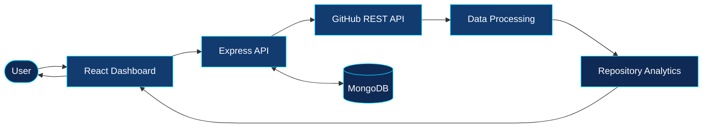
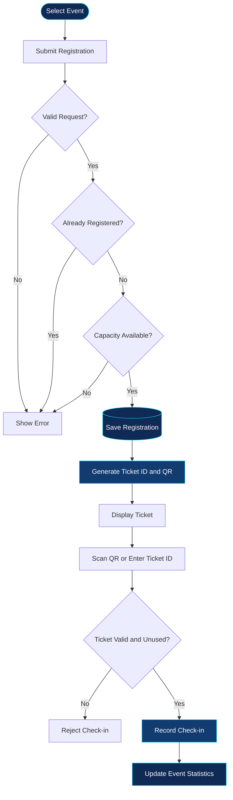

# `> PRIYANKA JAIN`

### Computer Science & AI Student · Full-Stack Developer · Problem Solver

Building practical web applications, exploring backend architecture, and turning ideas into working software.

[GitHub](https://github.com/Priyanka170974) · [LinkedIn](https://www.linkedin.com/in/priyanka-jain-1b8978339) · [LeetCode](https://leetcode.com/u/MCXH1ncUcC/)

---

## `01 / SYSTEM PROFILE`

```yaml
developer:
  name: Priyanka Jain
  education: B.Tech — CSE (AI)
  college: Arya College of Engineering
  focus:
    - Full-Stack Development
    - REST API Design
    - Database-Driven Applications
    - Problem Solving
  currently_building: Web applications with MERN
```

## `02 / TECH STACK`

| Layer | Technologies |
|---|---|
| Languages | C, Java, JavaScript |
| Frontend | HTML5, CSS3, React, Vite |
| Backend | Node.js, Express.js, REST APIs |
| Databases | MongoDB, MySQL |
| Tools | Git, GitHub, VS Code |
| Concepts | Authentication, Authorization, CRUD, API Integration |

---

## `03 / FEATURED PROJECTS`

### 01 — GitPulse
**GitHub Repository Analytics Dashboard**

A MERN-stack application designed to turn GitHub repository information into a structured analytics dashboard.

**Core workflow**



**Highlights**
- Repository data retrieval through the GitHub API
- Repository language and contributor insights
- Commit activity and dashboard metrics
- JWT-based authentication and MongoDB persistence
- User-specific repository analytics

**Stack:** React · Vite · Node.js · Express.js · MongoDB · Mongoose · JWT

[→ View Source Code](https://github.com/Priyanka170974/GitPulse)

---

### 02 — EventFlow
**Event Registration & Smart Check-in Platform**

A platform for managing event registrations, issuing digital tickets, and validating attendee check-ins.

**Registration and check-in workflow**



**Highlights**
- Organizer and volunteer roles
- Event creation and management
- Registration capacity and duplicate checks
- QR-based tickets and PDF support
- QR scanning and manual ticket lookup
- Check-in validation and event statistics

**Stack:** React · Vite · Node.js · Express.js · MongoDB · Mongoose · JWT

[→ View Source Code](https://github.com/Priyanka170974/Event-Registration-Smart-Checkin) · [→ Live Demo](https://event-registration-smart-checkin.vercel.app/)

---

### 03 — Code-Master-Quiz
**Interactive Programming Quiz Platform**

A browser-based quiz experience for practising programming concepts with timed questions and interactive feedback.

**Highlights**
- Programming questions across multiple languages
- Countdown timer and score tracking
- Interactive answer feedback
- Leaderboard and result experience
- Animated visual effects

**Stack:** HTML · CSS · JavaScript

[→ Source Code](https://github.com/Priyanka170974/Code-Master-Quiz) · [→ Live Demo](https://priyanka170974.github.io/Code-Master-Quiz/)

---

### 04 — AWT Calculator
**Java Desktop GUI Application**

A desktop calculator built using Java Abstract Window Toolkit, demonstrating event-driven programming and graphical user interface fundamentals.

**Highlights**
- AWT-based desktop interface
- Button event handling
- Arithmetic operations
- Input and result display

**Stack:** Java · AWT · Event Handling

[→ View Source Code](https://github.com/Priyanka170974/AWT-Calculator)

---

### 05 — Stopwatch
**Interactive Time Tracking Application**

A responsive stopwatch application with time controls and a polished visual interface.

**Highlights**
- Start, pause, resume, and reset
- Lap tracking and lap-history controls
- Dark-mode interface
- Responsive layout and visual effects

**Stack:** HTML · CSS · JavaScript

[→ Source Code](https://github.com/Priyanka170974/StopwatchWebiste) · [→ Live Demo](https://priyanka170974.github.io/StopwatchWebiste/)

---

## `04 / ENGINEERING APPROACH`

```text
IDEA
  ↓
BREAK DOWN THE REQUIREMENTS
  ↓
DESIGN THE DATA FLOW
  ↓
BUILD THE UI AND API
  ↓
CONNECT THE DATABASE
  ↓
TEST THE WORKFLOW
  ↓
DEPLOY · ITERATE · IMPROVE
```

I focus on understanding how components communicate, how data moves through an application, and how to handle both successful and unsuccessful requests.

## `05 / CURRENT FOCUS`

- Strengthening full-stack development fundamentals
- Practising data structures and algorithms
- Building practical, portfolio-ready applications
- Improving API design and database workflows

## `06 / CONNECT`

Open to learning opportunities, collaborative projects, and software development internships.

- **GitHub:** [Priyanka170974](https://github.com/Priyanka170974)
- **LinkedIn:** [Connect with me](https://www.linkedin.com/in/priyanka-jain-1b8978339)
- **LeetCode:** [Problem-solving profile](https://leetcode.com/u/MCXH1ncUcC/)

---

<p align="center">
  <sub>DESIGN · BUILD · DEBUG · ITERATE</sub>
</p>
