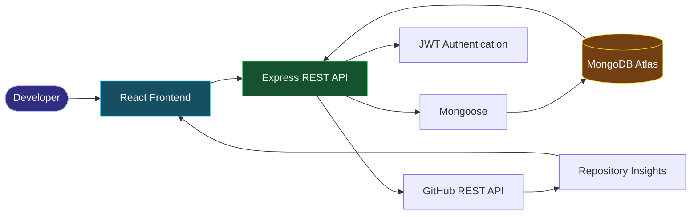

<div align="center">

# ⚡ PRIYANKA JAIN

### `Computer Science & AI` | `Full-Stack Developer in Progress`


<a href="https://github.com/Priyanka170974">

</a>
<a href="https://www.linkedin.com/in/priyanka-jain-1b8978339">

</a>
<a href="https://leetcode.com/u/MCXH1ncUcC/">

</a>


</div>

## 🧬 `WHO_AM_I`

```java
class Developer {
    String name = "Priyanka Jain";
    String education = "B.Tech CSE & AI";
    String college = "Arya College of Engineering";
    String focus = "Full-Stack Development";

    String[] interests = {
        "Web Development",
        "Java & DSA",
        "Artificial Intelligence",
        "Building Real Projects"
    };

    void mission() {
        System.out.println("Learn. Build. Improve. Repeat.");
    }
}
```

- 🔭 Building practical web applications
- 🌱 Learning frontend, backend APIs, and database integration
- 🧠 Practising Java and Data Structures & Algorithms
- 🤖 Exploring AI-powered software ideas
- 🎯 Working towards software development internships

---

## ⚙️ `TECHNOLOGY_STACK`

<div align="center">

### Languages


### Frontend Engineering


### Backend & Data


### Tools & Workflow


</div>

---

## 🚀 `PROJECTS_IN_ACTION`

<table>
<tr>
<td width="50%" valign="top">

### ⚡ GitPulse

**Repository Intelligence Dashboard**

A developer-focused dashboard for exploring GitHub repository information and activity.

- GitHub REST API integration
- Repository and language insights
- Contributor information
- JWT authentication
- MongoDB integration

**Stack:** React · Vite · Express · MongoDB

<a href="https://github.com/Priyanka170974/GitPulse">

</a>

</td>
<td width="50%" valign="top">

### 🎟️ EventFlow

**Event Registration & Smart Check-in**

A full-stack platform for event registration, ticketing, and attendee validation.

- Organizer and volunteer roles
- Registration and capacity checks
- QR-code scanning
- PDF tickets
- Check-in validation

**Stack:** React · Node.js · Express · MongoDB

<a href="https://github.com/Priyanka170974/Event-Registration-Smart-Checkin">

</a>

</td>
</tr>
<tr>
<td width="50%" valign="top">

### 🧠 Code-Master-Quiz

An interactive coding quiz with timed questions and score tracking.

**Stack:** HTML · CSS · JavaScript

<a href="https://priyanka170974.github.io/Code-Master-Quiz/">

</a>
<a href="https://github.com/Priyanka170974/Code-Master-Quiz">

</a>

</td>
<td width="50%" valign="top">

### ⏱️ Stopwatch Website

A browser-based stopwatch for practising interactive JavaScript and UI development.

**Stack:** HTML · CSS · JavaScript

<a href="https://priyanka170974.github.io/StopwatchWebiste/">

</a>
<a href="https://github.com/Priyanka170974/StopwatchWebiste">

</a>

</td>
</tr>
</table>

### 🧮 More Development

**AWT Calculator** — Java desktop application for practising GUI components.

<a href="https://github.com/Priyanka170974/AWT-Calculator">View AWT Calculator repository →</a>

---

## 🏗️ `SYSTEM_ARCHITECTURE`

### GitPulse — Request & Data Flow



---

## 📊 `GITHUB_ANALYTICS`

<div align="center">

<a href="https://github.com/Priyanka170974">

</a>

<a href="https://github.com/Priyanka170974">

</a>

<br/>


<br/>


</div>

---

## 🧭 `CURRENT_ROADMAP`

| Area | Current Focus |
|---|---|
| Java | OOP and programming fundamentals |
| DSA | Arrays, strings, recursion and core algorithms |
| Frontend | React and responsive interfaces |
| Backend | REST APIs and Express.js |
| Database | MongoDB and data modelling |
| AI | Exploring practical AI integrations |

---

## 🎓 `EDUCATION`

**Arya College of Engineering**  
B.Tech — Computer Science & Artificial Intelligence  
Third Year

**Certification:** NPTEL — Introduction to Programming in C

---

## 🤝 `CONNECT`

<div align="center">

<a href="https://github.com/Priyanka170974">

</a>
<a href="https://www.linkedin.com/in/priyanka-jain-1b8978339">

</a>
<a href="https://leetcode.com/u/MCXH1ncUcC/">

</a>

### `BUILD → TEST → LEARN → REPEAT`

*Thanks for visiting my developer profile.*

</div>
