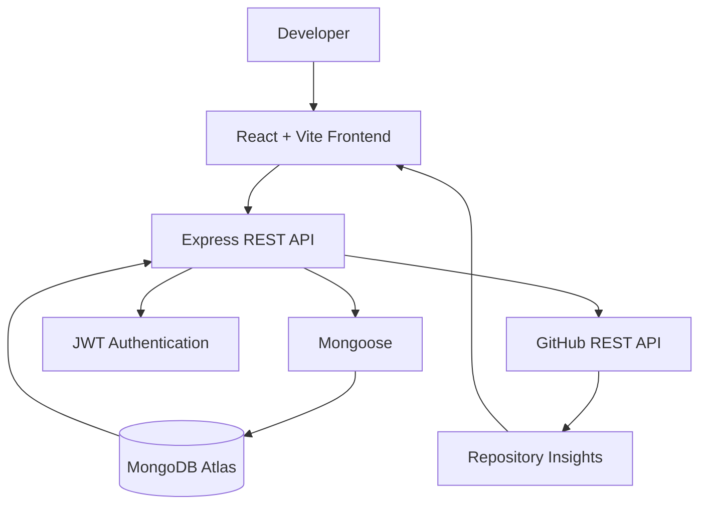

<div align="center">


### Building useful products by connecting interfaces, APIs, and data.

<a href="https://github.com/Priyanka170974"></a>
<a href="https://www.linkedin.com/in/priyanka-jain-1b8978339"></a>
<a href="https://leetcode.com/u/MCXH1ncUcC/"></a>


</div>

---

## 👩‍💻 About Me

I'm a **B.Tech Computer Science & Artificial Intelligence student at Arya College of Engineering**, currently in my third year.

I enjoy building practical applications, exploring new technologies, and understanding how frontend interfaces, backend APIs, and databases work together.

- 🔭 **Currently building:** Full-stack web applications
- 🌱 **Learning:** React, Node.js, Express.js, MongoDB
- 💻 **Practising:** Java, Data Structures & Algorithms
- 🤖 **Interested in:** AI-powered applications and problem solving
- 🎯 **Goal:** Become a skilled developer by building real-world projects

> My approach: Learn the fundamentals, build something useful, test it, and keep improving.

---

## 🚀 Featured Project — GitPulse

<div align="center">


### Repository Intelligence & Analytics Dashboard

**A developer dashboard that brings GitHub repository insights into one place.**

<a href="https://github.com/Priyanka170974/GitPulse"></a>

</div>

### ✨ Key Features

- 📊 Repository overview and metadata
- 💻 Programming-language insights
- 👥 Contributor information
- 📈 Repository activity summaries
- 🔗 GitHub REST API integration
- 🔐 JWT-based authentication
- 🗄️ MongoDB and Mongoose integration

### 🏗️ Architecture



**Tech Stack**

`React` `Vite` `Node.js` `Express.js` `MongoDB` `Mongoose` `JWT` `GitHub API`

---

## 🛠️ Other Projects

### 1. EventFlow — Event Registration & Smart Check-in

A full-stack event platform designed to manage registrations, tickets, and attendee check-ins.

- Organizer and volunteer roles
- JWT authentication and password hashing
- Event-capacity and duplicate-registration checks
- Ticket IDs and QR-code scanning
- PDF ticket support
- Check-in validation and registration statistics

**Tech:** React · Node.js · Express.js · MongoDB · JWT

<a href="https://github.com/Priyanka170974/Event-Registration-Smart-Checkin"></a>

### 2. Code-Master-Quiz

An interactive coding quiz project for practising programming concepts.

- Timed quiz sessions
- Interactive questions
- Score-focused experience

**Tech:** HTML · CSS · JavaScript

<a href="https://priyanka170974.github.io/Code-Master-Quiz/"></a>
<a href="https://github.com/Priyanka170974/Code-Master-Quiz"></a>

### 3. AWT Calculator

A Java desktop calculator created to practise GUI components and event-driven programming.

**Tech:** Java · AWT

<a href="https://github.com/Priyanka170974/AWT-Calculator">View Source Code →</a>

### 4. Stopwatch Website

A browser-based stopwatch with interactive time-tracking controls.

- Start, pause, and reset
- Lap tracking
- Interactive interface

**Tech:** HTML · CSS · JavaScript

<a href="https://priyanka170974.github.io/StopwatchWebiste/"></a>
<a href="https://github.com/Priyanka170974/StopwatchWebiste"></a>

---

## 💻 Tech Stack

<div align="center">


</div>

| Category | Technologies |
|---|---|
| Languages | C, Java, JavaScript |
| Frontend | HTML5, CSS3, React, Vite |
| Backend | Node.js, Express.js, REST APIs |
| Databases | MongoDB, Mongoose, MySQL |
| Authentication | JWT, bcrypt, role-based access |
| Tools | Git, GitHub, VS Code |
| Currently improving | DSA, Operating Systems, backend development |

---

## ⚙️ My Development Workflow

<div align="center">

`UNDERSTAND` → `PLAN` → `BUILD` → `TEST` → `IMPROVE`

</div>

I try to consider more than just the interface:

- 🎨 **User experience:** Is the application easy to use?
- ⚙️ **Logic:** Are the main flows and edge cases handled?
- 🗃️ **Data:** Is information validated and stored consistently?
- 🔐 **Security:** Are authentication and permissions considered?
- 🧪 **Testing:** Can I identify and fix unexpected behaviour?
- 🚀 **Delivery:** Can another person run or explore the project?

---

## 📊 GitHub Statistics

<div align="center">


</div>

---

## 🎯 Currently Learning

```text
Computer Science & AI
│
├── Programming
│   ├── C fundamentals
│   └── Java and OOP
│
├── Problem Solving
│   └── Data Structures & Algorithms
│
├── Frontend Development
│   └── HTML, CSS, JavaScript, React
│
├── Backend Development
│   └── Node.js, Express, REST APIs
│
├── Databases
│   └── MongoDB, Mongoose, MySQL
│
└── Exploring
    └── Practical AI applications
```

### My Current Goals

- Strengthen Java and DSA fundamentals
- Improve React and API development
- Understand authentication and database design
- Build complete frontend-to-backend applications
- Explore useful AI integrations

---

## 🎓 Education

**Arya College of Engineering**

B.Tech — Computer Science & Artificial Intelligence  
Third Year

**Certification:** NPTEL — Introduction to Programming in C

---

## 🤝 Let's Connect

I'm interested in learning opportunities, internships, collaborative projects, and constructive feedback.

<div align="center">

<a href="https://github.com/Priyanka170974"></a>

<a href="https://www.linkedin.com/in/priyanka-jain-1b8978339"></a>

<a href="https://leetcode.com/u/MCXH1ncUcC/"></a>

<br/><br/>


### Curiosity → Code → Engineering → Impact

*Thanks for visiting my profile. One project, one lesson, and one improvement at a time.*

</div>
