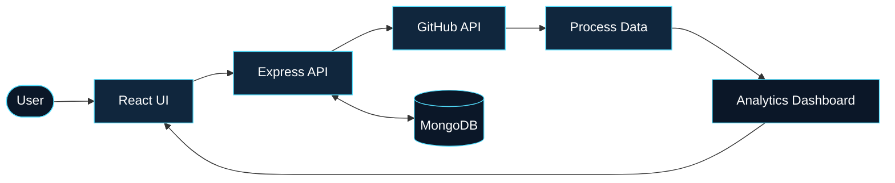
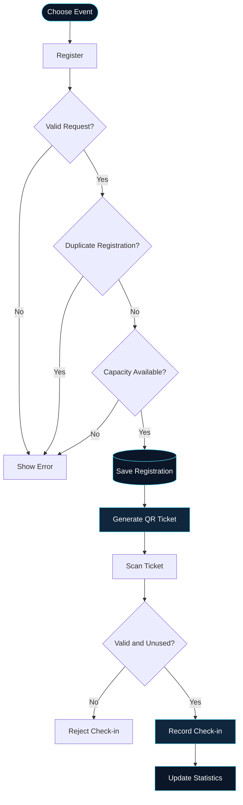

# `pj/engineering`

<p align="center">
  
</p>

<p align="center">
  <a href="https://github.com/Priyanka170974">GitHub</a> &nbsp;·&nbsp;
  <a href="https://www.linkedin.com/in/priyanka-jain-1b8978339">LinkedIn</a> &nbsp;·&nbsp;
  <a href="https://leetcode.com/u/MCXH1ncUcC/">LeetCode</a>
</p>

<p align="center">
  <b>Computer Science & AI Student</b><br/>
  Full-Stack Development · Application Design · Problem Solving
</p>

---

### 01 — A little about me

I’m a Computer Science and AI student interested in building applications that combine thoughtful interfaces with reliable backend logic.

I enjoy understanding how systems work end to end — how a user action becomes an API request, how data is processed and stored, and how the result becomes a useful experience.

Currently focused on strengthening my full-stack development skills through hands-on projects and continuous learning.

### 02 — Technical toolkit

| Area | Technologies |
|---|---|
| Languages | C, Java, JavaScript |
| Frontend | HTML, CSS, React, Vite |
| Backend | Node.js, Express.js, REST APIs |
| Databases | MongoDB, Mongoose, MySQL |
| Tools | Git, GitHub, VS Code |
| Concepts | JWT authentication, role-based access, CRUD, API integration |

---

### 03 — Selected work

#### 01 / GitPulse
**Repository analytics dashboard**

A MERN application that brings GitHub repository information into a structured dashboard with repository metrics and contributor insights.



- GitHub API integration
- Repository language and contributor insights
- Commit activity and analytics
- JWT-based authentication
- MongoDB-backed application data

**Stack:** React · Vite · Node.js · Express.js · MongoDB · Mongoose

[View source code →](https://github.com/Priyanka170974/GitPulse)

---

#### 02 / EventFlow
**Event registration & smart check-in**

An event management platform for handling registrations, generating digital tickets, and validating attendee check-ins.



- Organizer and volunteer roles
- Event creation and management
- Registration capacity and duplicate checks
- QR ticket generation and PDF support
- QR scanning and manual ticket lookup
- Check-in validation and event statistics

**Stack:** React · Node.js · Express.js · MongoDB · Mongoose · JWT

[Source code →](https://github.com/Priyanka170974/Event-Registration-Smart-Checkin) · [Live demo →](https://event-registration-smart-checkin.vercel.app/)

---

#### 03 / Code-Master-Quiz
**Interactive programming quiz**

A browser-based quiz application featuring timed questions, score tracking, interactive feedback, and a leaderboard experience.

**Highlights:** Countdown timer · Score tracking · Interactive feedback · Result experience

**Stack:** HTML · CSS · JavaScript

[Source code →](https://github.com/Priyanka170974/Code-Master-Quiz) · [Live demo →](https://priyanka170974.github.io/Code-Master-Quiz/)

---

#### 04 / AWT Calculator
**Java desktop application**

A graphical calculator demonstrating Java AWT components, arithmetic operations, and event-driven programming.

**Highlights:** Desktop GUI · Button event handling · Arithmetic operations

**Stack:** Java · AWT

[Source code →](https://github.com/Priyanka170974/AWT-Calculator)

---

#### 05 / Stopwatch
**Time-control interface**

A responsive stopwatch featuring time controls, lap tracking, and a dark-mode interface.

**Highlights:** Start, pause and reset · Lap history · Responsive design · Dark mode

**Stack:** HTML · CSS · JavaScript

[Source code →](https://github.com/Priyanka170974/StopwatchWebiste) · [Live demo →](https://priyanka170974.github.io/StopwatchWebiste/)

---

### 04 — How I approach engineering

```text
Understand the problem
        ↓
Break it into components
        ↓
Design the data flow
        ↓
Build and validate
        ↓
Test, debug, improve
```

I believe good development comes from understanding the problem clearly, writing maintainable code, and improving through practical implementation.

### 05 — What I'm working towards

- Stronger full-stack development fundamentals
- Consistent data structures and algorithms practice
- Better API design and database modelling
- Building practical projects with clear, useful workflows

---

<p align="center">
  
  <br/><br/>
  <b>Thoughtful design. Reliable logic. Continuous growth.</b><br/>
  <sub>PRIYANKA JAIN · BUILT ONE ITERATION AT A TIME</sub>
</p>
