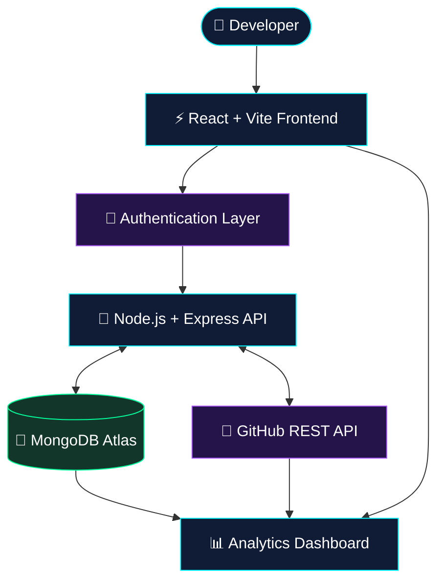

<div align="center">


<br/>


<br/><br/>

<a href="https://github.com/Priyanka170974/GitPulse">

</a>


<br/><br/>

**A developer-focused dashboard to explore GitHub repositories, track activity, and turn coding data into useful insights.**

<br/>

[Explore Repository](https://github.com/Priyanka170974/GitPulse) • [Developer Profile](https://github.com/Priyanka170974)

</div>

---

<div align="center">

## `01 // SYSTEM OVERVIEW`

</div>

GitPulse is a web-based GitHub analytics project that brings repository information and development activity into a centralized dashboard.

The goal is simple: **make repository data easier to explore, understand, and visualize.**

<table>
<tr>
<td width="50%">

### ◈ REPOSITORY ANALYTICS

- Repository information
- Programming language distribution
- Commit activity overview
- Contribution information

</td>
<td width="50%">

### ◈ DEVELOPER EXPERIENCE

- Centralized dashboard
- User authentication
- Structured API integration
- Data-driven visual interface

</td>
</tr>
</table>

---

<div align="center">

## `02 // DASHBOARD PREVIEW`

</div>

<div align="center">


<sub>Replace this image with a real screenshot of your project.</sub>

</div>

---

<div align="center">

## `03 // SYSTEM ARCHITECTURE`

</div>



---

<div align="center">

## `04 // TECHNOLOGY STACK`

**BUILT WITH THE MERN ECOSYSTEM**

<br/>


</div>

| Layer | Technologies |
|---|---|
| Frontend | React, Vite, JavaScript |
| Backend | Node.js, Express.js |
| Database | MongoDB Atlas, Mongoose |
| Authentication | JSON Web Tokens (JWT) |
| Integration | GitHub REST API |
| Development | Git, GitHub, VS Code |

---

<div align="center">

## `05 // FEATURE MODULES`

</div>

<details>
<summary><b>⚡ Module 01 — Repository Intelligence</b></summary>

View available repository details and organize useful development information in one place.

</details>

<details>
<summary><b>📈 Module 02 — Language Analytics</b></summary>

Explore programming language distribution for supported repositories.

</details>

<details>
<summary><b>🔄 Module 03 — Activity Tracking</b></summary>

Present available commit and contribution activity in a dashboard-friendly format.

</details>

<details>
<summary><b>🔐 Module 04 — Authentication</b></summary>

Use JWT-based authentication for protected user-specific functionality.

</details>

<details>
<summary><b>🌐 Module 05 — GitHub API Integration</b></summary>

Connect to GitHub's API to retrieve supported repository and activity data.

</details>

<details>
<summary><b>🗄️ Module 06 — Data Management</b></summary>

Use MongoDB and Mongoose for the application's configured data persistence.

</details>

---

<div align="center">

## `06 // PROJECT LINKS`

<a href="https://github.com/Priyanka170974/GitPulse">

</a>

<a href="https://github.com/Priyanka170974">

</a>

</div>

---

<div align="center">

## `07 // DEVELOPER STATISTICS`


<br/><br/>


</div>

---

<div align="center">

## `08 // DEVELOPMENT LOG`

</div>

```text
╔════════════════════════════════════════════╗
║           GITPULSE SYSTEM LOG              ║
╠════════════════════════════════════════════╣
║  MODULE    Frontend Interface              ║
║  STACK     React + Vite                   ║
║  MODULE    Backend API                    ║
║  STACK     Node.js + Express              ║
║  MODULE    Data Persistence               ║
║  STACK     MongoDB + Mongoose             ║
║  MODULE    Authentication                 ║
║  STACK     JWT                            ║
║  MODULE    Repository Data                ║
║  SOURCE    GitHub REST API                ║
╚════════════════════════════════════════════╝
```

---

<div align="center">

## `09 // THE DEVELOPER`

**Designed and developed by Priyanka Jain**

<a href="https://github.com/Priyanka170974">

</a>

<br/><br/>


<br/><br/>


### `BUILD. ANALYZE. IMPROVE.`

<sub>GitPulse — turning repository activity into developer insights.</sub>

</div>
