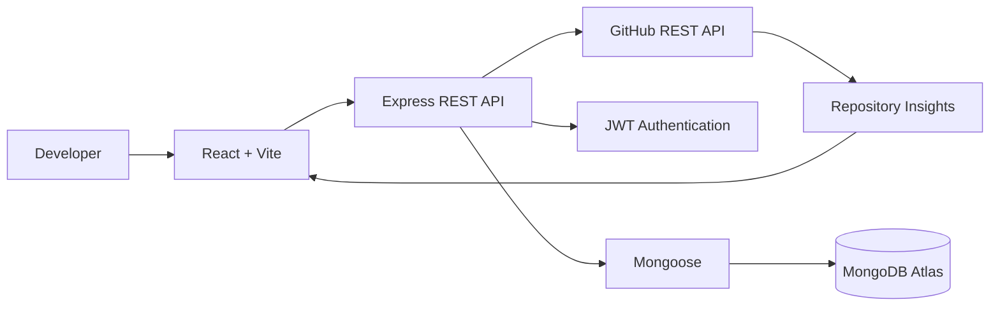

Building useful products by connecting interfaces, APIs, and data.

  
  
  

01 — A little about me
I'm a B.Tech Computer Science & Artificial Intelligence student at Arya College of Engineering. I enjoy building applications that solve practical problems and learning how the pieces fit together—from a user interface to APIs, authentication, and databases.
- Currently focused on: Full-stack development and backend fundamentals
- Building with: React, JavaScript, Node.js, Express, and MongoDB
- Practising: Java, data structures, algorithms, and problem solving
- Interested in: Thoughtful product design, reliable APIs, and practical AI applications
My engineering mindset: Make it work. Understand why it works. Improve how it works.

02 — Featured build: GitPulse

  
  <h3>Repository Intelligence & Analytics Dashboard</h3>
  
<em>Make repository activity easier to explore and understand.</em>

  

The idea: GitPulse brings useful GitHub repository information into one developer-friendly dashboard instead of making users inspect every detail separately.
Area	What it does
Repository overview	Presents repository metadata
Language insights	Displays the language composition reported for a repository
Contributor information	Surfaces available contributor data
Commit activity	Helps users inspect repository activity
Pulse Score	Provides a compact activity summary
GitHub API integration	Retrieves available repository information
Authentication & data	JWT authentication with MongoDB/Mongoose

How the pieces connect

Stack: React · Vite · Node.js · Express · MongoDB · Mongoose · JWT · GitHub REST API
03 — Projects built to learn by doing
1. EventFlow — Event Registration & Smart Check-in
A full-stack event workflow covering event registration, ticket generation, and attendee check-in.
- Organizer and volunteer roles with access control
- JWT authentication and password hashing
- Event-capacity checks and duplicate-registration protection
- Ticket IDs, QR scanning, and PDF support
- Manual ticket lookup and check-in validation
- Registration statistics for event operations
Stack: React · Node.js · Express · MongoDB · JWT

  
  

2. Code-Master-Quiz
An interactive coding quiz designed to make programming practice more engaging.
- Timed quiz sessions
- Interactive question handling
- Score and feedback-oriented experience
Stack: HTML · CSS · JavaScript

  
  

3. AWT Calculator
A Java desktop application for practising GUI components and event-driven programming.
- Interactive calculator controls
- Arithmetic operation handling
- GUI components and event listeners
Stack: Java · AWT

View source code
4. Stopwatch
A browser-based stopwatch focused on time tracking and interactive controls.
- Start, pause, and reset
- Lap tracking and history
- Responsive interface
Stack: HTML · CSS · JavaScript

  
  

04 — My toolkit

  

Category	Technologies
Languages	C, Java, JavaScript
Frontend	HTML5, CSS3, React, Vite
Backend	Node.js, Express.js, REST APIs
Databases	MongoDB, Mongoose, MySQL
Security	JWT, bcrypt, role-based authorization
Tools	Git, GitHub, VS Code, IntelliJ IDEA
Exploring	DSA, Operating Systems, backend design, AI applications

05 — How I approach a build

UNDERSTAND → PLAN → BUILD → TEST → DEPLOY → ITERATE

I try to think beyond the visible UI:
- User experience: Is the flow clear and easy to use?
- Application logic: Are requests and edge cases handled?
- Data: Is information stored and validated consistently?
- Security: Are authentication and permissions considered?
- Reliability: Can I reproduce, debug, and fix unexpected behaviour?
- Delivery: Can someone else run the project or try the live demo?
06 — GitHub activity

  
  
   
  
   
  

07 — What I'm learning next
Computer Science & AI
├── Programming
│   ├── C fundamentals
│   └── Java and OOP
├── Problem solving
│   └── Data Structures & Algorithms
├── Frontend
│   └── HTML, CSS, JavaScript, React
├── Backend
│   └── Node.js, Express, REST APIs, authentication
├── Data
│   └── MongoDB, Mongoose, MySQL
└── Exploring
    └── Practical AI-powered applications
Current priorities
- Strengthen DSA and problem-solving fundamentals
- Improve React and API design
- Understand authentication and database architecture
- Build complete, reliable frontend-to-backend workflows
- Explore practical AI integrations
08 — Education
Arya College of Engineering
B.Tech — Computer Science & Artificial Intelligence · Third Year

Certification: NPTEL — Introduction to Programming in C
09 — Let's connect
I'm open to learning opportunities, internships, collaborative projects, and constructive feedback that help me grow as a developer.

  
  
  

  

  

  Curiosity → Code → Engineering → Impact

  Thanks for visiting — one project, one lesson, and one improvement at a time.

