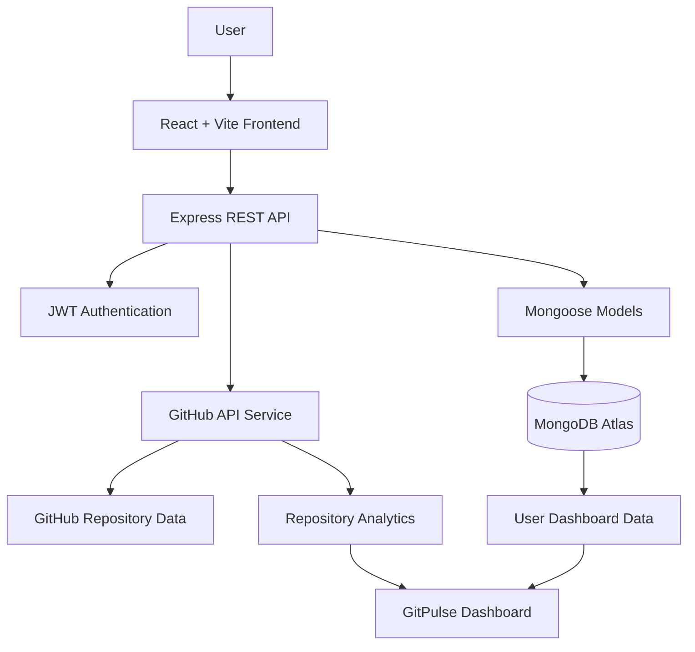

# ⚡ GitPulse — Your GitHub Repository, Decoded.

<p align="center">
  
  
  
</p>

<p align="center">
  <b>Turn repository activity into meaningful insights.</b><br/>
  Understand your codebase, explore contribution patterns, and track repository health from one unified dashboard.
</p>

<p align="center">
  <a href="https://github.com/Priyanka170974/GitPulse">📂 Repository</a> •
  <a href="https://git-pulse-phi.vercel.app/">🌐 Live Application</a> •
  <a href="#-about-the-developer">👩‍💻 Developer</a>
</p>

---

## ✦ The Idea Behind GitPulse

A GitHub repository contains more than source code. It reflects development activity, collaboration, programming language choices, and the evolution of a project over time.

**GitPulse** transforms repository information into a clear, visual analytics experience.

Instead of manually exploring multiple GitHub pages, users can enter a public repository URL and explore available insights through a single dashboard.

Whether you're reviewing your own project, exploring an open-source codebase, or learning how a repository evolves, GitPulse helps make repository information easier to understand.

## 🚀 What Can You Explore?

| Feature | Description |
|---|---|
| 📊 Repository Dashboard | Brings available repository metrics together |
| 💓 Pulse Score | Summarizes repository activity |
| 💻 Language Insights | Visualizes programming language distribution |
| 👥 Contributor Analytics | Displays available contributor information |
| 📈 Commit Activity | Helps explore commit history and development patterns |
| 📥 Clone Activity | Displays GitHub-reported clone traffic when accessible |
| 🌱 Repository Origin | Shows available origin or fork information |
| 🔐 Authentication | Uses JWT-based authentication for protected features |
| 👤 Personal Dashboard | Associates saved repository data with the authenticated user |

> **Data integrity:** GitHub restricts some repository traffic statistics to users with the required permissions. GitPulse distinguishes unavailable metrics from actual zero values instead of inventing analytics.

## 🎯 Why GitPulse?

- **One dashboard:** Explore repository insights in one place.
- **Visual understanding:** Interpret language distribution and activity patterns.
- **Repository exploration:** Investigate repositories through their GitHub URLs.
- **User-specific experience:** Keep authenticated application features associated with the correct user.
- **Honest analytics:** Distinguish actual data, unavailable metrics, and missing activity.

## 🧰 Technology Stack

### Frontend

<p>
  
  
  
  
</p>

### Backend and Database

<p>
  
  
  
  
  
</p>

### API and Development Tools

<p>
  
  
  
</p>

## 🏗️ System Architecture



The frontend handles user interaction and visualization. The Express backend coordinates API requests, authentication, and database operations. GitHub provides repository information, while MongoDB stores application data.

## 🔄 How GitPulse Works

1. **Authenticate** — Sign in to access protected application features.
2. **Enter a repository** — Provide a GitHub repository URL.
3. **Fetch available data** — Request repository information through the backend.
4. **Process insights** — Organize available metrics for dashboard presentation.
5. **Store application data** — Manage relevant user and repository records.
6. **Explore the dashboard** — Review repository details, language insights, contributors, and available activity analytics.

## 📸 Screenshots

Add screenshots of the actual application to showcase the interface.

| Repository Dashboard | Language Insights |
|---|---|
| Replace with `docs/screenshots/dashboard.png` | Replace with `docs/screenshots/languages.png` |

| Contributor Analytics | Clone Activity |
|---|---|
| Replace with `docs/screenshots/contributors.png` | Replace with `docs/screenshots/clones.png` |

Upload your screenshots to `docs/screenshots/` and replace these placeholders with the actual images before publishing.

## ⚙️ Getting Started

### Prerequisites

- Node.js and npm
- Git
- A MongoDB Atlas account or another supported MongoDB deployment
- A GitHub account and token configured for features that require it

### 1. Clone the repository

```bash
git clone https://github.com/Priyanka170974/GitPulse.git
cd GitPulse
```

### 2. Install backend dependencies

```bash
cd backend
npm install
```

Create a `backend/.env` file using the variable names required by the current backend.

Example:

```env
PORT=5000
MONGO_URI=your_mongodb_connection_string
JWT_SECRET=replace_with_a_long_random_secret
JWT_EXPIRES_IN=7d
CLIENT_URL=http://localhost:5173
GITHUB_TOKEN=your_github_token
```

Keep real credentials private. Never commit your actual `.env` file or expose API tokens.

Start the backend using the script configured in `backend/package.json`, for example:

```bash
npm run dev
```

### 3. Install frontend dependencies

Open a second terminal from the project root:

```bash
cd frontend
npm install
npm run dev
```

Open the local URL printed by Vite, commonly `http://localhost:5173`.

Check the existing environment configuration before setting the frontend API URL.

## 🔐 Security and Data Integrity

- Store credentials in environment variables.
- Never commit database passwords, API tokens, or real `.env` files.
- Keep protected backend routes behind the implemented authentication and authorization checks.
- Handle GitHub API rate limits and permission errors.
- Display clone statistics only when GitHub provides access to the relevant endpoint.
- Do not interpret unavailable analytics as proof that a repository has no activity.

## 🧪 Testing

Run the commands configured in the project's package files.

For example, if the corresponding scripts exist:

```bash
npm test
npm run build
```

Verify the scripts in the relevant `package.json` before using these commands.

## 🌍 Deployment

A typical deployment setup is:

| Component | Platform |
|---|---|
| Frontend | Vercel |
| Backend | Render |
| Database | MongoDB Atlas |

Before deploying:

1. Configure production environment variables.
2. Set the frontend API URL to the deployed backend.
3. Configure the backend's allowed client origin.
4. Configure MongoDB Atlas network access.
5. Verify authentication, API connectivity, and repository analytics.
6. Confirm that private credentials are not exposed in the frontend bundle or repository.

**Live application:** [GitPulse on Vercel](https://git-pulse-phi.vercel.app/)

## 🗺️ Roadmap

Potential future improvements:

- More detailed repository activity timelines
- Repository comparison
- Exportable analytics reports
- Historical analytics snapshots
- Enhanced contributor activity visualization
- Better API error and rate-limit feedback

These are possible future improvements, not claims that the features are already implemented.

---

# 👩‍💻 About the Developer

<p align="center">
  
</p>

<h2 align="center">Hi, I'm Priyanka Jain 👋</h2>

<p align="center">
  <b>CSE (AI) Student | Aspiring Full-Stack Developer | Problem-Solving Enthusiast</b>
</p>

<p align="center">
  <i>Learning, building, experimenting, and turning ideas into projects.</i>
</p>

I'm a third-year B.Tech student in Computer Science Engineering (Artificial Intelligence) at **Arya College of Engineering**.

I'm interested in building interactive web experiences, developing full-stack applications, strengthening my problem-solving skills, and exploring Artificial Intelligence.

I enjoy learning through hands-on projects and continuously improving my development skills.

### 🎓 Education

| Detail | Information |
|---|---|
| Name | Priyanka Jain |
| Degree | B.Tech — Computer Science Engineering (AI) |
| College | Arya College of Engineering |
| Current Year | Third Year |
| Career Interests | Frontend Development, Full-Stack Development, DSA and AI |

### 🌐 Connect With Me

<p align="center">
  <a href="https://github.com/Priyanka170974">
    
  </a>
  <a href="https://www.linkedin.com/in/priyanka-jain-1b8978339/">
    
  </a>
  <a href="https://leetcode.com/u/MCXH1ncUcC/">
    
  </a>
  <a href="https://github.com/Priyanka170974/GitPulse">
    
  </a>
</p>

### 💻 Technical Skills

**Programming Languages**

<p>
  
  
</p>

**Frontend Development**

<p>
  
  
  
  
</p>

**Backend Development**

<p>
  
  
  
</p>

**Tools and Core Learning Areas**

<p>
  
  
  
  
  
</p>

### 🚀 Featured Projects

<table>
  <thead>
    <tr>
      <th>Project</th>
      <th>About</th>
      <th>Links</th>
    </tr>
  </thead>
  <tbody>
    <tr>
      <td><b>⚡ GitPulse</b></td>
      <td>Full-stack GitHub repository analytics dashboard with visual repository insights.</td>
      <td><a href="https://github.com/Priyanka170974/GitPulse">Repository</a> · <a href="https://git-pulse-phi.vercel.app/">Live App</a></td>
    </tr>
    <tr>
      <td><b>🎟️ EventFlow</b></td>
      <td>Event registration and smart check-in platform with ticketing and QR-based check-in functionality.</td>
      <td><a href="https://github.com/Priyanka170974/Event-Registration-Smart-Checkin">Repository</a></td>
    </tr>
    <tr>
      <td><b>🧠 Code-Master-Quiz</b></td>
      <td>Programming quiz website featuring coding questions, a timer, and leaderboard functionality.</td>
      <td><a href="https://github.com/Priyanka170974/Code-Master-Quiz">Repository</a> · <a href="https://priyanka170974.github.io/Code-Master-Quiz/">Live Demo</a></td>
    </tr>
    <tr>
      <td><b>🧮 AWT Calculator</b></td>
      <td>Calculator project for practicing programming and application development.</td>
      <td><a href="https://github.com/Priyanka170974/AWT-Calculator">Repository</a></td>
    </tr>
    <tr>
      <td><b>⏱️ Stopwatch Website</b></td>
      <td>A stopwatch web project with a live demo link.</td>
      <td><a href="https://github.com/Priyanka170974/StopwatchWebiste">Repository</a> · <a href="https://priyanka170974.github.io/StopwatchWebiste/">Live Demo</a></td>
    </tr>
  </tbody>
</table>

<p align="center">
  <a href="https://github.com/Priyanka170974?tab=repositories">
    
  </a>
</p>

### 📊 GitHub and LeetCode Statistics

<p align="center">
  <b>GitHub Profile — Priyanka170974</b>
</p>

<p align="center">
  <a href="https://github.com/Priyanka170974">
    
  </a>
  <a href="https://github.com/Priyanka170974?tab=repositories">
    
  </a>
</p>

<p align="center">
  <a href="https://github.com/Priyanka170974">
    
  </a>
</p>

<p align="center">
  <b>LeetCode Profile — MCXH1ncUcC</b>
</p>

<p align="center">
  <a href="https://leetcode.com/u/MCXH1ncUcC/">
    
  </a>
</p>

<p align="center">
  <a href="https://leetcode.com/u/MCXH1ncUcC/">
    
  </a>
</p>

> **Statistics note:** These cards are intended to display profile-wide GitHub and LeetCode information from external services. They are not GitPulse project analytics. Values depend on each service's availability, caching, and access to public data. No contribution totals, solved counts, ranks, or streaks are manually claimed here. If a card fails to load, use the linked profile directly.

### 🎯 Current Focus

- Strengthening Java and Data Structures & Algorithms.
- Practicing problem-solving and coding interview fundamentals.
- Building responsive frontend experiences and full-stack applications.
- Exploring Artificial Intelligence and emerging development tools.
- Improving through consistent hands-on practice.

### ✨ My Developer Philosophy

> Learn by building. Improve by experimenting. Grow by staying consistent.

I'm continuously learning and working on projects that help me connect programming fundamentals with practical development.

---

## 🤝 Contributions

Suggestions, bug reports, and improvements are welcome.

1. Fork the repository.
2. Create a feature branch.
3. Make your changes and test them.
4. Open a pull request describing your improvement.

## 📄 License

Add a `LICENSE` file and specify the selected license before distributing this project under an open-source license.

---

<p align="center">
  
  
</p>

<p align="center">
  <b>GitPulse ⚡</b><br/>
  <i>See the activity. Understand the code. Follow the pulse.</i><br/><br/>
  <a href="https://github.com/Priyanka170974">Priyanka Jain</a> ·
  <a href="https://github.com/Priyanka170974/GitPulse">GitHub Repository</a>
</p>
