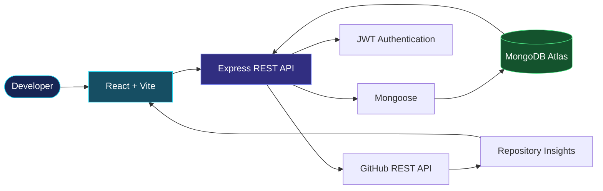

<div align="center">


# PRIYANKA JAIN

### `FULL-STACK DEVELOPER IN PROGRESS`

**CSE & Artificial Intelligence · Software Engineering · Web Development**


[](https://github.com/Priyanka170974)
[](https://www.linkedin.com/in/priyanka-jain-1b8978339)
[](https://leetcode.com/u/MCXH1ncUcC/)

</div>

---

<div align="center">

`SYS_CORE: ONLINE`　|　`ARCH: MERN`　|　`FOCUS: SOFTWARE ENGINEERING`

</div>

## ⚡ `01 // ABOUT_ME`

<table>
<tr>
<td width="65%" valign="top">

### Hi, I'm Priyanka 👋

I'm a third-year **B.Tech Computer Science & Artificial Intelligence student at Arya College of Engineering**.

I enjoy developing practical applications and learning how frontend interfaces, backend services, and databases work together.

- 🔭 Building full-stack projects
- 🌱 Learning React, Node.js, Express and MongoDB
- 💻 Practising Java and Data Structures & Algorithms
- 🤖 Exploring AI-powered applications
- 🎯 Working towards software development internships

</td>
<td width="35%" valign="top">

### `CURRENT_FOCUS`

| Domain | Focus |
|---|---|
| Frontend | React |
| Backend | Node.js |
| Database | MongoDB |
| Language | Java |
| Problem solving | DSA |
| Exploration | AI |

</td>
</tr>
</table>

---

## 🛠️ `02 // TECH_STACK`

<div align="center">

**PROGRAMMING**


**FRONTEND ENGINEERING**


**BACKEND & DATA**


**DEVELOPER TOOLS**


</div>

---

## 🚀 `03 // DEPLOYED_IDEAS`

<table>
<tr>
<td width="50%" valign="top">

### ◈ GitPulse

**Repository Intelligence Dashboard**

A developer dashboard for exploring GitHub repository information and activity insights.

`REACT` `VITE` `EXPRESS` `MONGODB` `GITHUB API`

- Repository metadata and language insights
- Contributor information
- Backend API integration
- JWT authentication

[](https://github.com/Priyanka170974/GitPulse)

</td>
<td width="50%" valign="top">

### ◈ EventFlow

**Event Registration & Smart Check-in**

A full-stack event platform for registration, ticketing, and attendee validation.

`REACT` `NODE.JS` `EXPRESS` `MONGODB`

- Organizer and volunteer roles
- Registration and capacity validation
- QR-code check-in
- PDF ticket support

[](https://github.com/Priyanka170974/Event-Registration-Smart-Checkin)

</td>
</tr>
<tr>
<td width="50%" valign="top">

### ◈ Code-Master-Quiz

Interactive coding quiz with timed questions and a score-focused experience.

`HTML` `CSS` `JAVASCRIPT`

[](https://priyanka170974.github.io/Code-Master-Quiz/)

[Source repository](https://github.com/Priyanka170974/Code-Master-Quiz)

</td>
<td width="50%" valign="top">

### ◈ Stopwatch Website

Browser-based stopwatch for practising JavaScript logic and interactive interfaces.

`HTML` `CSS` `JAVASCRIPT`

[](https://priyanka170974.github.io/StopwatchWebiste/)

[Source repository](https://github.com/Priyanka170974/StopwatchWebiste)

</td>
</tr>
</table>

### Additional Project

**AWT Calculator** — Java desktop calculator for practising GUI components and event-driven programming.

[View AWT Calculator](https://github.com/Priyanka170974/AWT-Calculator)

---

## 🏗️ `04 // SYSTEM_ARCHITECTURE`

### GitPulse — High-Level Data Flow



---

## 📈 `05 // GITHUB_METRICS`

<div align="center">

<a href="https://github.com/Priyanka170974">

</a>

<a href="https://github.com/Priyanka170974">

</a>


</div>

---

## 🧠 `06 // LEARNING_PROTOCOL`

```text
[01] UNDERSTAND  -> Break down the problem
[02] DESIGN      -> Plan the solution
[03] IMPLEMENT   -> Write the code
[04] VALIDATE    -> Test important cases
[05] IMPROVE     -> Refactor and document
```

### Current Roadmap

- [ ] Strengthen Java and OOP fundamentals
- [ ] Practise DSA consistently
- [ ] Improve React and responsive UI development
- [ ] Build robust REST APIs
- [ ] Learn database design and validation
- [ ] Explore practical AI integrations

---

## 🎓 `07 // EDUCATION`

**Arya College of Engineering**  
B.Tech — Computer Science & Artificial Intelligence · Third Year

**Certification:** NPTEL — Introduction to Programming in C

---

## 🤝 `08 // ESTABLISH_CONNECTION`

<div align="center">

[](https://github.com/Priyanka170974)
[](https://www.linkedin.com/in/priyanka-jain-1b8978339)
[](https://leetcode.com/u/MCXH1ncUcC/)

**BUILD WITH PURPOSE. DEBUG WITH PATIENCE. LEARN CONTINUOUSLY.**

`END OF TRANSMISSION // THANKS FOR VISITING`

</div>
