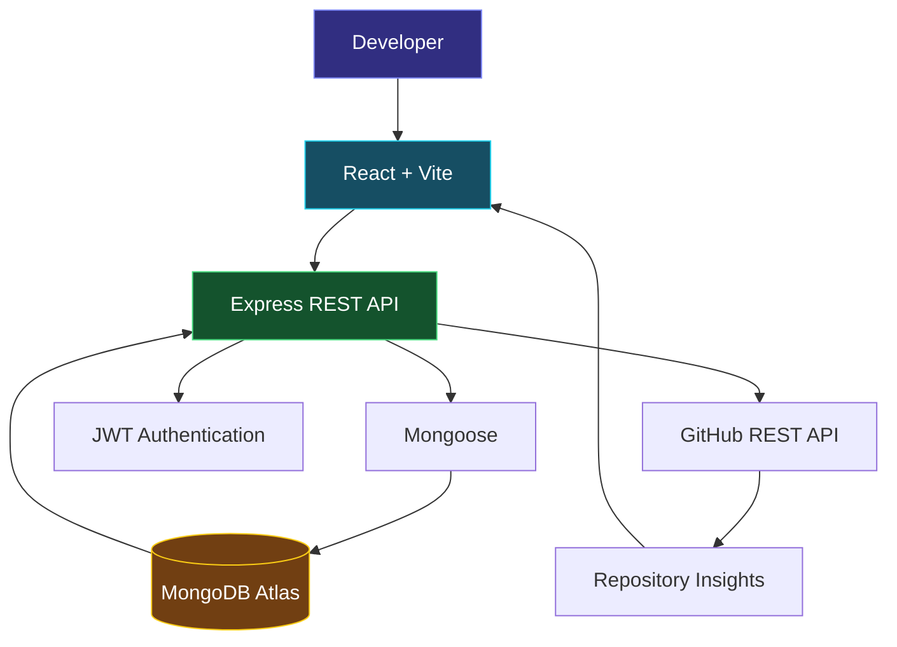

<!-- =====================================================
     PRIYANKA JAIN | GITHUB PROFILE README
     Replace the entire content of your README.md with this.
====================================================== -->

<div align="center">

# 👩‍💻 Priyanka Jain

### Computer Science & Artificial Intelligence Student

**Full-Stack Development • Problem Solving • AI Exploration**

Building practical applications with clean code, useful features, and real-world problem solving.

<p>
  <a href="https://github.com/Priyanka170974">
    
  </a>
  <a href="https://www.linkedin.com/in/priyanka-jain-1b8978339">
    
  </a>
  <a href="https://leetcode.com/u/MCXH1ncUcC/">
    
  </a>
</p>

</div>

---

## `01` — About Me

Hi! I'm a third-year **B.Tech Computer Science & Artificial Intelligence student at Arya College of Engineering**.

I am interested in software development and enjoy turning ideas into working applications. I am building my skills in frontend development, backend APIs, databases, and problem solving.

- 🔭 **Building:** Full-stack web applications
- 🌱 **Learning:** React, Node.js, Express.js, MongoDB
- 💻 **Practising:** Java, Data Structures & Algorithms
- 🤖 **Exploring:** AI-powered applications
- 🎯 **Goal:** Develop reliable software and gain practical industry experience

---

## `02` — Technology Stack

### Programming Languages

<p>
  
  
  
</p>

### Frontend Development

<p>
  
  
  
  
</p>

### Backend Development

<p>
  
  
  
</p>

### Databases & Authentication

<p>
  
  
  
  
</p>

### Developer Tools

<p>
  
  
  
</p>

---

## `03` — Featured Project

### 🚀 GitPulse | Repository Intelligence Dashboard

A developer dashboard designed to bring GitHub repository information and activity insights into one place.

**Core technologies:** React · Vite · Node.js · Express.js · MongoDB · Mongoose · GitHub REST API · JWT

**Project highlights**

- GitHub repository information and metadata
- Programming-language and contributor insights
- Repository activity summaries
- Backend API integration
- Authentication using JWT
- Database integration using MongoDB and Mongoose

**Architecture**



<div align="center">

<a href="https://github.com/Priyanka170974/GitPulse">
  
</a>

</div>

---

## `04` — Project Portfolio

### 📅 EventFlow — Event Registration & Smart Check-in

A full-stack platform for managing event registrations and attendee check-ins.

- Organizer and volunteer roles
- JWT-based authentication
- Event capacity and duplicate-registration checks
- Ticket IDs, QR-code scanning, and PDF tickets
- Registration statistics and check-in validation

**Stack:** React · Node.js · Express.js · MongoDB · Mongoose

[](https://github.com/Priyanka170974/Event-Registration-Smart-Checkin)

### 🧠 Code-Master-Quiz

An interactive coding quiz application featuring timed questions and a score-focused experience.

**Stack:** HTML · CSS · JavaScript

[](https://priyanka170974.github.io/Code-Master-Quiz/)
[](https://github.com/Priyanka170974/Code-Master-Quiz)

### 🧮 AWT Calculator

A Java desktop calculator created to practise graphical user interfaces and event-driven programming.

**Stack:** Java · AWT

[](https://github.com/Priyanka170974/AWT-Calculator)

### ⏱️ Stopwatch Website

A browser-based stopwatch project for practising JavaScript logic and interactive UI development.

**Stack:** HTML · CSS · JavaScript

[](https://priyanka170974.github.io/StopwatchWebiste/)
[](https://github.com/Priyanka170974/StopwatchWebiste)

---

## `05` — GitHub Analytics

<div align="center">

<a href="https://github.com/Priyanka170974">
  
</a>

<a href="https://github.com/Priyanka170974">
  
</a>

</div>

<div align="center">


</div>

---

## `06` — How I Approach Development

```text
Understand the problem
        ↓
Plan the solution
        ↓
Build the interface
        ↓
Develop APIs and data flow
        ↓
Test important cases
        ↓
Improve and document
```

I focus on understanding the logic behind a project, not just making the interface look good.

---

## `07` — Current Learning Roadmap

- [ ] Strengthen Java and object-oriented programming
- [ ] Practise Data Structures & Algorithms consistently
- [ ] Improve React and responsive UI development
- [ ] Build better REST APIs with Express.js
- [ ] Deepen MongoDB and database-design fundamentals
- [ ] Explore practical AI integrations in web applications

---

## `08` — Education

**Arya College of Engineering**

B.Tech — Computer Science & Artificial Intelligence  
Third Year

**Certification:** NPTEL — Introduction to Programming in C

---

## `09` — Let's Connect

I'm open to learning opportunities, collaborative projects, internships, and constructive feedback.

<div align="center">

<a href="https://github.com/Priyanka170974">
  
</a>
<a href="https://www.linkedin.com/in/priyanka-jain-1b8978339">
  
</a>
<a href="https://leetcode.com/u/MCXH1ncUcC/">
  
</a>

### Build with purpose. Learn continuously. Improve every day.

</div>
