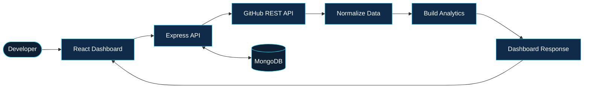
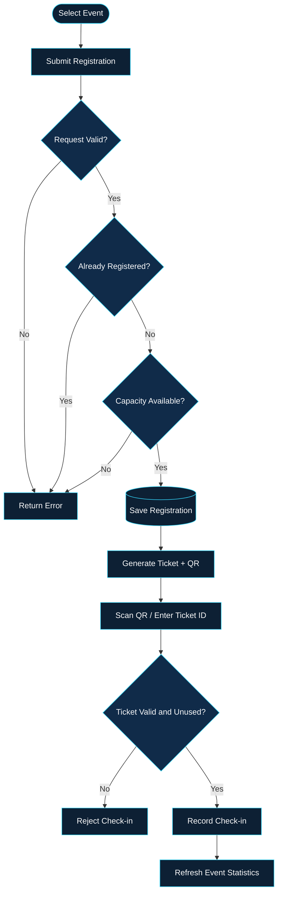

# PRIYANKA JAIN
### Engineering Dashboard · `PJ / 001`

<p align="center">
  
</p>

<p align="center">
  <b>Computer Science & AI Student</b><br/>
  Full-Stack Development · Data Flow · Application Engineering
</p>

<p align="center">
  <a href="https://github.com/Priyanka170974">GitHub Profile</a> &nbsp; / &nbsp;
  <a href="https://www.linkedin.com/in/priyanka-jain-1b8978339">LinkedIn</a> &nbsp; / &nbsp;
  <a href="https://leetcode.com/u/MCXH1ncUcC/">LeetCode</a>
</p>

---

<table>
<tr>
<td colspan="2">

### SYSTEM OVERVIEW

`IDENTITY: PRIYANKA.JAIN`  
`DOMAIN: COMPUTER SCIENCE / AI`  
`FOCUS: FULL-STACK DEVELOPMENT`  
`APPROACH: DESIGN → BUILD → TEST → REFINE`

</td>
</tr>
<tr>
<td width="50%">

**01 / APPLICATIONS**

Building usable interfaces and complete application workflows.

</td>
<td width="50%">

**02 / ENGINEERING**

Connecting APIs, databases, validation, and user experiences.

</td>
</tr>
</table>

## `01` — Technology Console

<table>
<tr><td><b>LANGUAGES</b></td><td>C · Java · JavaScript</td></tr>
<tr><td><b>FRONTEND</b></td><td>HTML · CSS · React · Vite</td></tr>
<tr><td><b>BACKEND</b></td><td>Node.js · Express.js · REST APIs</td></tr>
<tr><td><b>DATABASES</b></td><td>MongoDB · Mongoose · MySQL</td></tr>
<tr><td><b>TOOLS</b></td><td>Git · GitHub · VS Code</td></tr>
<tr><td><b>CONCEPTS</b></td><td>JWT · Role-Based Access · CRUD · API Integration</td></tr>
</table>

---

## `02` — Application Control Center

### `01 / GITPULSE`
**Repository Analytics · MERN Stack**

A dashboard that transforms GitHub repository information into useful analytics and contributor insights.



**System capabilities**
- GitHub repository data integration.
- Language and contributor insights.
- Commit activity and dashboard metrics.
- JWT-based authentication.
- MongoDB-backed user and application data.

<table>
<tr><td><b>FRONTEND</b></td><td>React · Vite</td></tr>
<tr><td><b>BACKEND</b></td><td>Node.js · Express.js</td></tr>
<tr><td><b>DATA</b></td><td>MongoDB · Mongoose</td></tr>
</table>

<p>
<a href="https://github.com/Priyanka170974/GitPulse">↗ EXPLORE SOURCE CODE</a>
</p>

---

### `02 / EVENTFLOW`
**Event Registration · Smart Check-in**

An event management platform for registration, digital ticketing, and attendee verification.



**System capabilities**
- Organizer and volunteer roles.
- Event creation and management.
- Registration capacity and duplicate checks.
- QR ticket generation and PDF support.
- Camera scanning and manual ticket lookup.
- Check-in validation and event statistics.

**STACK:** React · Node.js · Express.js · MongoDB · Mongoose · JWT

<p>
<a href="https://github.com/Priyanka170974/Event-Registration-Smart-Checkin">↗ SOURCE CODE</a> &nbsp; · &nbsp;
<a href="https://event-registration-smart-checkin.vercel.app/">↗ LIVE DEMO</a>
</p>

---

### `03 / CODE-MASTER-QUIZ`
**Interactive Programming · Web Application**

A browser-based quiz experience featuring timed questions, score tracking, and interactive feedback.

```text
QUESTION → USER RESPONSE → EVALUATION → SCORE → RESULT
```

- Programming questions across multiple languages.
- Countdown timer and score tracking.
- Interactive answer feedback.
- Leaderboard and visual result effects.

**STACK:** HTML · CSS · JavaScript

[↗ SOURCE CODE](https://github.com/Priyanka170974/Code-Master-Quiz) · [↗ LIVE DEMO](https://priyanka170974.github.io/Code-Master-Quiz/)

---

### `04 / AWT CALCULATOR`
**Java · Desktop Interface**

A desktop calculator demonstrating GUI components, arithmetic operations, and event-driven programming.

```text
BUTTON EVENT → INPUT PROCESSING → CALCULATION → RESULT
```

- Java AWT graphical interface.
- Button event handling.
- Arithmetic operations and result display.

**STACK:** Java · AWT

[↗ SOURCE CODE](https://github.com/Priyanka170974/AWT-Calculator)

---

### `05 / STOPWATCH`
**Time-Control Interface · Frontend**

A responsive stopwatch with time controls and lap tracking.

```text
READY → START → PAUSE / RESUME → RESET
                    └── LAP TRACKING
```

- Start, pause, resume, and reset.
- Lap tracking and lap-history controls.
- Dark mode and responsive layout.
- Mountain-inspired visual interface.

**STACK:** HTML · CSS · JavaScript

[↗ SOURCE CODE](https://github.com/Priyanka170974/StopwatchWebiste) · [↗ LIVE DEMO](https://priyanka170974.github.io/StopwatchWebiste/)

---

## `03` — Data Flow Laboratory

The core of my engineering approach is understanding how data moves between components, how requests are validated, and how results reach the user.

```text
┌─────────────┐     ┌─────────────┐     ┌─────────────┐
│ USER INPUT  │ ──► │ API / LOGIC │ ──► │ DATA LAYER  │
└─────────────┘     └─────────────┘     └─────────────┘
                           │                    │
                           ▼                    ▼
                    ┌─────────────┐     ┌─────────────┐
                    │ VALIDATION  │     │ PERSISTENCE │
                    └─────────────┘     └─────────────┘
                           │                    │
                           └─────────┬──────────┘
                                     ▼
                            ┌────────────────┐
                            │ USER RESPONSE  │
                            └────────────────┘
```

### Motion layer

For a truly animated version, create a looping GIF of the GitPulse pipeline and upload it to this profile repository. Then replace the comment below with an image link pointing to the uploaded GIF.

```html
<!-- Replace YOUR_ANIMATED_GIF_URL with the URL of your uploaded GIF. -->
<!--
<p align="center">
  
</p>
-->
```

The diagram above works as a static fallback. The GIF is optional and must be uploaded before enabling the animation.

---

## `04` — Development Protocol

```text
01  UNDERSTAND THE PROBLEM
          ↓
02  BREAK IT INTO COMPONENTS
          ↓
03  DESIGN THE DATA FLOW
          ↓
04  IMPLEMENT & VALIDATE
          ↓
05  TEST, DEBUG, ITERATE
```

I focus on strengthening my fundamentals through practical projects, debugging, and continuous improvement.

## `05` — Current Direction

- Improving full-stack development fundamentals.
- Practising data structures and algorithms.
- Strengthening API and database design.
- Building practical portfolio projects.

---

<p align="center">
  
  <br/><br/>
  <b>ENGINEER THE LOGIC. DESIGN THE EXPERIENCE.</b><br/>
  <sub>PRIYANKA JAIN · END OF TRANSMISSION</sub>
</p>
