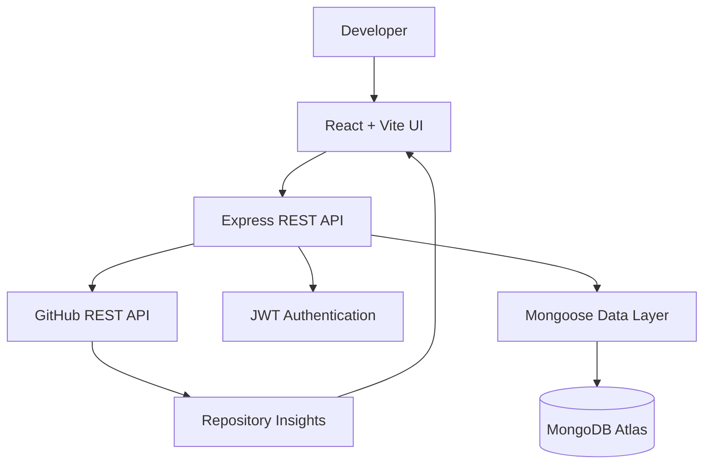

<div align="center">


<a href="https://github.com/Priyanka170974"></a>
<a href="https://www.linkedin.com/in/priyanka-jain-1b8978339"></a>
<a href="https://leetcode.com/u/MCXH1ncUcC/"></a>

<br/>


</div>

---

## `01 / ABOUT ME`

```javascript
const priyanka = {
  name: "Priyanka Jain",
  degree: "B.Tech — Computer Science & AI",
  college: "Arya College of Engineering",
  year: "Third Year",
  interests: [
    "Full-Stack Development",
    "Backend Engineering",
    "REST APIs",
    "Database Design",
    "Problem Solving"
  ],
  mindset: "Understand → Build → Debug → Improve"
};
```

Hey! I'm Priyanka, a Computer Science and Artificial Intelligence student passionate about building useful software and understanding how applications work beyond the interface.

I enjoy connecting frontend experiences with backend logic, APIs, authentication, and databases. With every project, I'm working to strengthen my problem-solving skills and understand the engineering decisions behind a complete application.

> **My principle:** Don't just make it work. Understand why it works.

---

## `02 / FEATURED PROJECT — GITPULSE`

<div align="center">


### Repository Intelligence & Analytics Dashboard

**Turning GitHub repository data into easier-to-explore insights.**

<a href="https://github.com/Priyanka170974/GitPulse"></a>

</div>

GitPulse is a repository analytics project focused on bringing repository information and activity insights into a developer-friendly dashboard.

| Module | Purpose |
|---|---|
| Repository Analytics | Presents repository metadata |
| Language Insights | Shows programming-language composition |
| Contributor Information | Explores available contributor data |
| Commit Activity | Helps inspect repository activity |
| Pulse Score | Summarizes repository activity |
| GitHub API | Retrieves available repository information |
| Authentication | JWT-based user authentication |
| Data Layer | MongoDB with Mongoose |

### Architecture



<div align="center">


</div>

---

## `03 / PROJECT GALLERY`

### ◈ EventFlow — Event Registration & Smart Check-in


A full-stack event management platform connecting event creation, attendee registration, ticket generation, and check-in.

- Organizer and volunteer access controls
- JWT authentication and password hashing
- Event capacity and duplicate-registration checks
- Ticket generation and PDF support
- QR scanning and manual ticket lookup
- Check-in validation and registration statistics

**Tech:** React · Node.js · Express · MongoDB · JWT

[🌐 Live Demo](https://event-registration-smart-checkin.vercel.app/) · [💻 Source Code](https://github.com/Priyanka170974/Event-Registration-Smart-Checkin)

---

### ◈ Code-Master-Quiz

An interactive coding quiz that makes programming practice more engaging through timed questions and dynamic feedback.

- Timed quiz sessions
- Interactive question handling
- Score and feedback-oriented experience


[🌐 Live Demo](https://priyanka170974.github.io/Code-Master-Quiz/) · [💻 Source Code](https://github.com/Priyanka170974/Code-Master-Quiz)

---

### ◈ AWT Calculator

A Java desktop calculator exploring GUI components, arithmetic operations, and event-driven programming.

- Interactive calculator controls
- Arithmetic operation handling
- GUI components and event listeners


[💻 Source Code](https://github.com/Priyanka170974/AWT-Calculator)

---

### ◈ Stopwatch

A browser-based stopwatch focused on time tracking, interactive controls, and lap history.

- Start, pause, and reset
- Lap tracking and history management
- Responsive interface


[🌐 Live Demo](https://priyanka170974.github.io/StopwatchWebiste/) · [💻 Source Code](https://github.com/Priyanka170974/StopwatchWebiste)

---

## `04 / TECH STACK`

<div align="center">

**LANGUAGES**


**FRONTEND**


**BACKEND & DATABASES**


**TOOLS**


</div>

| Domain | Technologies |
|---|---|
| Languages | C, Java, JavaScript |
| Frontend | HTML5, CSS3, React, Vite |
| Backend | Node.js, Express.js, REST APIs |
| Databases | MongoDB, Mongoose, MySQL |
| Security | JWT, bcrypt, role-based authorization |
| Tools | Git, GitHub, VS Code, IntelliJ IDEA |
| Exploring | DSA, Operating Systems, Backend Design, AI Applications |

---

## `05 / ENGINEERING WORKFLOW`

<div align="center">

`UNDERSTAND` → `PLAN` → `BUILD` → `TEST` → `DEPLOY` → `IMPROVE`

</div>

- **Frontend:** Clear and intuitive user interactions
- **Backend:** Request validation and application logic
- **Database:** Structured and consistent data
- **Security:** Authentication and access control
- **Reliability:** Debugging unexpected failures
- **Deployment:** Making applications available online

---

## `06 / GITHUB INSIGHTS`

<div align="center">

<a href="https://github.com/Priyanka170974">

</a>
<a href="https://github.com/Priyanka170974">

</a>

<br/><br/>


<br/><br/>


</div>

---

## `07 / LEARNING ROADMAP`

```text
COMPUTER SCIENCE & AI
├── Programming Fundamentals
│   ├── C
│   └── Java & OOP
├── Problem Solving
│   └── Data Structures & Algorithms
├── Frontend Engineering
│   ├── HTML / CSS / JavaScript
│   └── React
├── Backend Engineering
│   ├── Node.js / Express
│   ├── REST APIs
│   └── Authentication
├── Data Management
│   ├── MongoDB / Mongoose
│   └── MySQL
└── Emerging Interests
    └── AI-powered Applications
```

### Current priorities

- Strengthen DSA and problem-solving fundamentals
- Improve React and backend API design
- Understand authentication and database architecture
- Build complete frontend-to-backend workflows
- Explore practical AI integrations

---

## `08 / EDUCATION & CERTIFICATION`

<div align="center">


</div>

**Arya College of Engineering**

B.Tech — Computer Science & Artificial Intelligence  
Third Year

**Certification:** NPTEL — Introduction to Programming in C

---

## `09 / LET'S CONNECT`

I'm interested in meaningful software projects, internships, collaboration, and opportunities to learn from real engineering challenges.

<div align="center">

<a href="https://github.com/Priyanka170974"></a>

<a href="https://www.linkedin.com/in/priyanka-jain-1b8978339"></a>

<a href="https://leetcode.com/u/MCXH1ncUcC/"></a>

<br/><br/>


### `THINK DEEPLY. BUILD WITH PURPOSE.`

**Curiosity → Code → Engineering → Impact**

<sub>Thanks for visiting my profile. Learning, building, and improving one project at a time.</sub>

</div>
