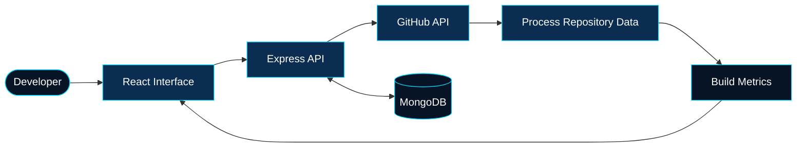
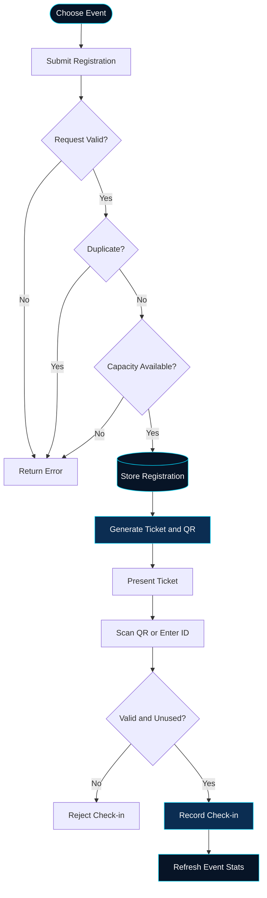

# `PRIYANKA.JAIN`

```text
┌─────────────────────────────────────────────────────────────┐
│  CYBERPULSE :: DEVELOPER CONTROL ROOM                        │
│  STATUS   : LEARNING / BUILDING / ITERATING                 │
│  DOMAIN   : COMPUTER SCIENCE · AI · FULL-STACK               │
└─────────────────────────────────────────────────────────────┘
```

<p align="center">
  
</p>

<p align="center">
  <b>Computer Science & AI Student · Full-Stack Developer</b><br/>
  Building practical applications by connecting interfaces, APIs, databases, and real-world workflows.
</p>

<p align="center">
  <a href="https://github.com/Priyanka170974">GITHUB</a> ·
  <a href="https://www.linkedin.com/in/priyanka-jain-1b8978339">LINKEDIN</a> ·
  <a href="https://leetcode.com/u/MCXH1ncUcC/">LEETCODE</a>
</p>

---

## `01 // DEVELOPER_IDENTITY`

```yaml
name: Priyanka Jain
education: B.Tech in Computer Science & AI
college: Arya College of Engineering

engineering_interests:
  - Full-Stack Web Development
  - REST API Architecture
  - Database-Driven Applications
  - Authentication & Authorization
  - Problem Solving

current_mode: Learn → Build → Debug → Improve
```

I enjoy understanding how an application works beyond its interface — from request handling and data validation to database operations and the final user experience.

## `02 // TECHNOLOGY_MATRIX`

| SYSTEM LAYER | TECHNOLOGIES |
|---|---|
| Programming | C · Java · JavaScript |
| Frontend | HTML5 · CSS3 · React · Vite |
| Backend | Node.js · Express.js · REST APIs |
| Data | MongoDB · Mongoose · MySQL |
| Developer Tools | Git · GitHub · VS Code |
| Application Concepts | JWT · Role-Based Access · CRUD · API Integration |

---

## `03 // PROJECT_LAB`

### `01. GITPULSE` — Repository Intelligence

**A GitHub repository analytics dashboard built with the MERN stack.**



**Engineering highlights**
- GitHub API integration for repository information.
- Repository language and contributor insights.
- Commit activity and analytics dashboard.
- JWT-based authentication and MongoDB persistence.
- User-specific repository tracking.

**Built with:** React · Vite · Node.js · Express.js · MongoDB · Mongoose · JWT

[EXPLORE REPOSITORY →](https://github.com/Priyanka170974/GitPulse)

---

### `02. EVENTFLOW` — Registration & Smart Check-in

**An event management platform designed around digital tickets and attendee validation.**



**Engineering highlights**
- Organizer and volunteer roles.
- Event creation and management.
- Registration capacity and duplicate checks.
- QR ticket generation and PDF support.
- Camera-based QR scanning and manual ticket lookup.
- Check-in validation and event statistics.

**Built with:** React · Vite · Node.js · Express.js · MongoDB · Mongoose · JWT

[EXPLORE REPOSITORY →](https://github.com/Priyanka170974/Event-Registration-Smart-Checkin)  
[OPEN LIVE DEMO →](https://event-registration-smart-checkin.vercel.app/)

---

### `03. CODE-MASTER-QUIZ` — Interactive Learning

A programming quiz application focused on timed questions, feedback, scoring, and an engaging browser experience.

- Programming questions across multiple languages.
- Countdown timer and score tracking.
- Interactive answer feedback.
- Leaderboard and visual result effects.

**Built with:** HTML · CSS · JavaScript

[EXPLORE REPOSITORY →](https://github.com/Priyanka170974/Code-Master-Quiz)  
[OPEN LIVE DEMO →](https://priyanka170974.github.io/Code-Master-Quiz/)

---

### `04. AWT CALCULATOR` — Desktop Engineering

A Java desktop calculator demonstrating graphical interfaces and event-driven programming.

- Java AWT components.
- Button-driven event handling.
- Arithmetic operations and result display.

**Built with:** Java · AWT

[EXPLORE REPOSITORY →](https://github.com/Priyanka170974/AWT-Calculator)

---

### `05. STOPWATCH` — Time-Control Interface

A responsive browser-based stopwatch with time controls and lap tracking.

- Start, pause, resume, and reset.
- Lap tracking and lap-history controls.
- Dark mode and responsive layout.
- Custom mountain-inspired visual interface.

**Built with:** HTML · CSS · JavaScript

[EXPLORE REPOSITORY →](https://github.com/Priyanka170974/StopwatchWebiste)  
[OPEN LIVE DEMO →](https://priyanka170974.github.io/StopwatchWebiste/)

---

## `04 // ENGINEERING_PIPELINE`

```text
       ┌──────────────┐
       │   PROBLEM    │
       └──────┬───────┘
              ▼
       ┌──────────────┐
       │   DESIGN     │
       └──────┬───────┘
              ▼
       ┌──────────────┐
       │   IMPLEMENT  │
       └──────┬───────┘
              ▼
       ┌──────────────┐
       │ TEST & DEBUG │◄────┐
       └──────┬───────┘     │
              ▼             │
       ┌──────────────┐     │
       │   IMPROVE    │─────┘
       └──────────────┘
```

My approach is to break problems into smaller components, understand the data flow, validate edge cases, and improve the implementation through testing.

## `05 // CURRENT_OBJECTIVES`

- Strengthen full-stack development fundamentals.
- Practise data structures and algorithms.
- Improve backend and database design.
- Build practical, portfolio-ready projects.
- Learn through implementation, debugging, and iteration.

## `06 // CONNECTION_TERMINAL`

```text
$ connect --with-priyanka

GitHub   : github.com/Priyanka170974
LinkedIn : linkedin.com/in/priyanka-jain-1b8978339
LeetCode : leetcode.com/u/MCXH1ncUcC/

$ echo "Always building. Always learning."
```

<p align="center">
  
  <sub>DESIGN SYSTEMS · BUILD SOLUTIONS · KEEP ITERATING</sub>
</p>
