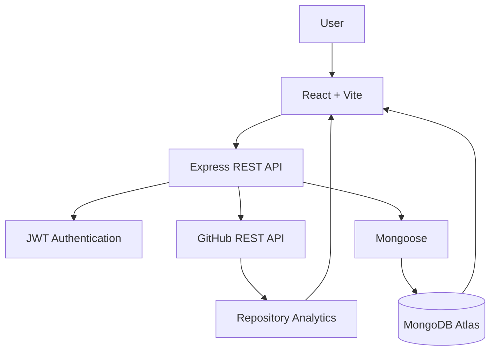
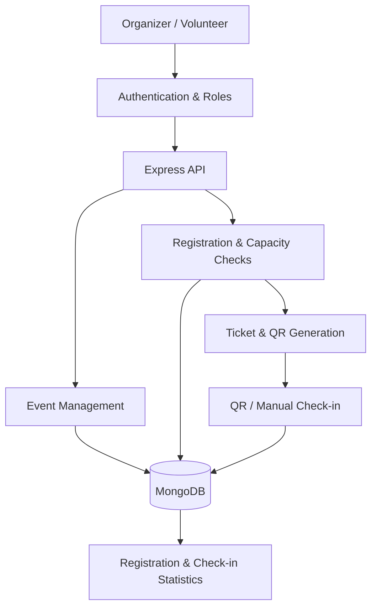
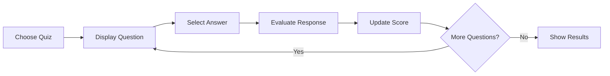
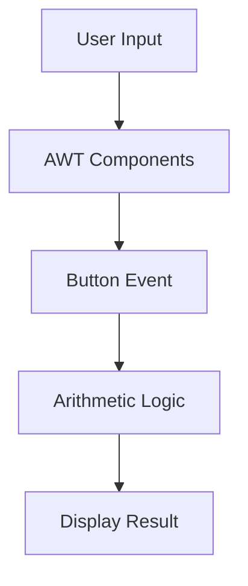
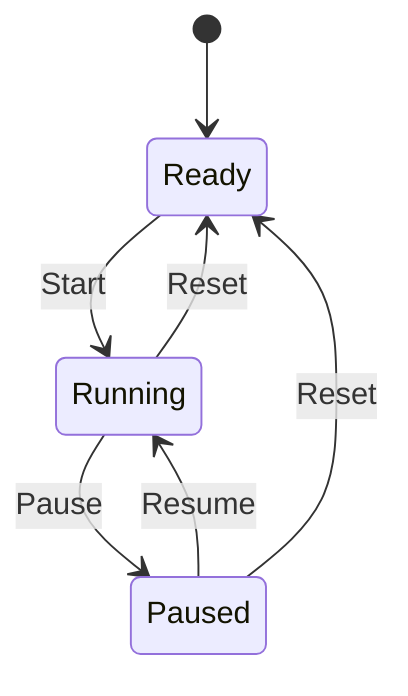

 <div align="center">


<br/>

`DESIGN SYSTEMS` &nbsp; / &nbsp; `ENGINEER SOLUTIONS` &nbsp; / &nbsp; `KEEP ITERATING`

**I build applications to understand what happens beneath the interface.**

[GitHub](https://github.com/Priyanka170974) · [LinkedIn](https://www.linkedin.com/in/priyanka-jain-1b8978339) · [LeetCode](https://leetcode.com/u/MCXH1ncUcC/)

</div>

---

## 00 — Developer specification

```yaml
identity:
  name: Priyanka Jain
  education: B.Tech — Computer Science & Artificial Intelligence
  institution: Arya College of Engineering
  year: Third Year

engineering_focus:
  - Full Stack Web Development
  - API and Backend Development
  - Database-Driven Applications
  - Problem Solving
  - AI-Integrated Software

primary_stack:
  languages: [C, Java, JavaScript]
  frontend: [HTML, CSS, React]
  backend: [Node.js, Express.js]
  databases: [MongoDB, MySQL]
  tools: [Git, GitHub, VS Code]
```

I'm a third-year CSE/AI student interested in building software that works as a complete system—from the first user interaction to backend processing and data storage.

I enjoy exploring how APIs, authentication, database design and frontend interfaces fit together. My projects are where I practise these concepts, solve integration problems and develop a stronger engineering mindset.

My current focus is improving my full-stack development skills while strengthening programming fundamentals and problem-solving.

---

## 01 — Engineering environment

<div align="center">

| Layer | Tools and technologies |
|:--|:--|
| **01 / Languages** | C · Java · JavaScript |
| **02 / Interface** | HTML5 · CSS3 · React · Vite |
| **03 / Server** | Node.js · Express.js · REST APIs |
| **04 / Persistence** | MongoDB · Mongoose · MySQL |
| **05 / Security** | JWT · bcrypt · Role-based authorization |
| **06 / Workflow** | Git · GitHub · VS Code · IntelliJ IDEA |

</div>

---

## 02 — Selected engineering work

# `01` GitPulse

### Repository intelligence and analytics

<text> </text>

**The idea:** turn GitHub repository information into a dashboard that makes project activity easier to understand.

GitPulse is my flagship full-stack project. It connects GitHub repository data with a visual analytics experience, bringing repository metadata, programming-language composition, contributor information and available activity statistics into one place.

<div align="center">


</div>

#### System design



#### Core modules

| Module | Purpose |
|:--|:--|
| Repository overview | Presents available repository metadata |
| Language analytics | Summarizes the programming-language composition |
| Contributor insights | Displays available contributor information |
| Commit activity | Helps users explore repository activity |
| Clone analytics | Displays clone traffic when GitHub authorizes access |
| Origin information | Shows available repository origin or fork relationships |
| User authentication | Supports authenticated application access |
| Data persistence | Stores application data using MongoDB and Mongoose |

#### Engineering concepts practised

- Integrating an external REST API into an application workflow
- Organizing backend code into routes, controllers and services
- Connecting React interfaces to backend endpoints
- Working with MongoDB through Mongoose
- Handling authentication and environment configuration
- Designing useful empty, loading and error states for unavailable data

**Stack:** React · Vite · Node.js · Express.js · MongoDB Atlas · Mongoose · GitHub REST API

<div align="center">

[**→ Explore GitPulse source code**](https://github.com/Priyanka170974/GitPulse)

</div>

---

# `02` EventFlow

### Event Registration & Smart Check-in Platform

**The idea:** connect event creation, attendee registration, ticket generation and entry verification in one application.

EventFlow is a full-stack event-management project designed around the complete attendee journey—from registering for an event to validating a ticket at check-in.

#### System design



#### Core modules

| Module | Purpose |
|:--|:--|
| Event management | Create and manage event information |
| Registration | Register attendees and validate capacity |
| Duplicate protection | Prevent repeated registrations for the same event |
| Ticket generation | Generate ticket identifiers, QR codes and PDFs |
| Smart check-in | Support QR scanning and manual ticket lookup |
| Role-based access | Separate organizer and volunteer permissions |
| Statistics | Track available registration and check-in counts |

#### Engineering concepts practised

- Designing a multi-role application
- Validating user input and registration constraints
- Connecting ticket generation with check-in workflows
- Managing application state across frontend and backend
- Working with database-backed event records

**Stack:** React · Node.js · Express.js · MongoDB · Mongoose · JWT · QR scanning

<div align="center">

[**→ Open live application**](https://event-registration-smart-checkin.vercel.app/)  
[**→ Explore source code**](https://github.com/Priyanka170974/Event-Registration-Smart-Checkin)

</div>

---

# `03` Code-Master-Quiz

### Interactive programming quiz

**The idea:** make programming practice more interactive through timed questions and immediate feedback.

Code-Master-Quiz is a browser-based quiz project focused on user interaction, programming knowledge and a responsive learning experience.

#### Application flow



#### Core modules

- Programming quiz interface
- Timed question sessions
- Interactive answer selection
- Score-oriented feedback
- Browser-based deployment through GitHub Pages

**Stack:** HTML · CSS · JavaScript

<div align="center">

[**→ Play live quiz**](https://priyanka170974.github.io/Code-Master-Quiz/)  
[**→ Explore source code**](https://github.com/Priyanka170974/Code-Master-Quiz)

</div>

---

# `04` AWT Calculator

### Java desktop application

**The idea:** apply programming fundamentals to a graphical desktop interface.

AWT Calculator is a Java desktop project that demonstrates graphical components, user interaction and event-driven arithmetic operations.

#### Application flow



#### Core modules

- Graphical interface using Java AWT
- Interactive buttons and event handling
- Arithmetic operation processing
- Input-to-result workflow

#### Engineering concepts practised

- Java fundamentals
- GUI component arrangement
- Event-driven programming
- Separating user interaction from calculation logic

**Stack:** Java · Abstract Window Toolkit (AWT)

<div align="center">

[**→ Explore source code**](https://github.com/Priyanka170974/AWT-Calculator)

</div>

---

# `05` Stopwatch

### Time-tracking web application

**The idea:** build a small but complete interactive tool using browser technologies.

The Stopwatch project focuses on time tracking, interactive controls and a responsive interface, with lap recording and history management.

#### Application flow



#### Core modules

- Start, pause, resume and reset controls
- Lap-time recording
- Lap-history management
- Responsive layout
- Themed interface and dark-mode support

#### Engineering concepts practised

- JavaScript event handling
- Managing interactive UI state
- Updating elapsed-time displays
- Separating timer logic from presentation

**Stack:** HTML · CSS · JavaScript

<div align="center">

[**→ Open live stopwatch**](https://priyanka170974.github.io/StopwatchWebiste/)  
[**→ Explore source code**](https://github.com/Priyanka170974/StopwatchWebiste)

</div>

---

## 03 — Engineering principles

```text
01  UNDERSTAND
    Define the problem and expected behaviour.

02  DECOMPOSE
    Break the system into manageable components.

03  IMPLEMENT
    Connect interface, logic, APIs and data.

04  VALIDATE
    Test normal cases, edge cases and failures.

05  ITERATE
    Debug, refine and improve the implementation.
```

I want every project to teach me more than just how to make a feature work. I also want to understand why it works, where it can fail and how its components communicate.

---

## 04 — GitHub activity

<div align="center">


<br/>


</div>

---

## 05 — Current learning direction

| Focus | Direction |
|:--|:--|
| Programming | C, Java and problem-solving fundamentals |
| DSA | Data structures and algorithmic thinking |
| Frontend | React components and interactive interfaces |
| Backend | REST API design and request validation |
| Databases | MongoDB, Mongoose and MySQL |
| Computer Science | Operating systems and core concepts |
| Exploration | AI-powered software applications |

### Education

**Arya College of Engineering**  
B.Tech — Computer Science & Artificial Intelligence · Third Year

**Certification:** NPTEL — Introduction to Programming in C

---

## 06 — Connect

I'm interested in software development, full-stack projects, internships and opportunities to learn from practical engineering challenges.

<div align="center">

[LinkedIn](https://www.linkedin.com/in/priyanka-jain-1b8978339) &nbsp; ◈ &nbsp; [LeetCode](https://leetcode.com/u/MCXH1ncUcC/) &nbsp; ◈ &nbsp; [GitHub](https://github.com/Priyanka170974)

<br/>


<sub>Learning through code. Growing through engineering.</sub>

</div>
