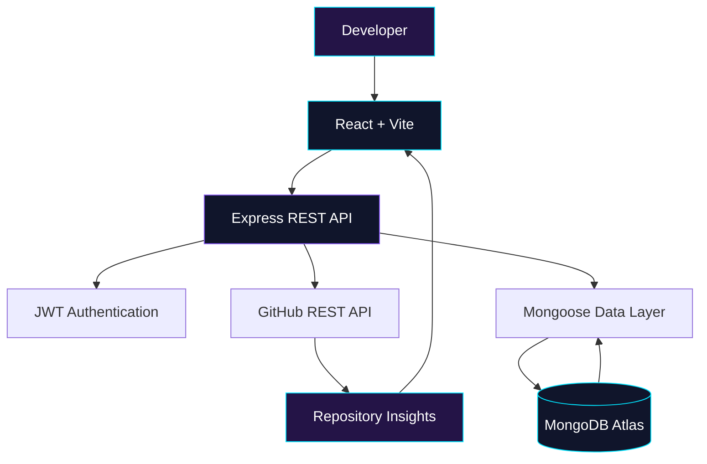

<div align="center">


<a href="https://github.com/Priyanka170974">

</a>

<br/>

<a href="https://github.com/Priyanka170974">

</a>
<a href="https://www.linkedin.com/in/priyanka-jain-1b8978339">

</a>
<a href="https://leetcode.com/u/MCXH1ncUcC/">

</a>

<br/><br/>


</div>

---

## ⚡ 01. THE DEVELOPER BEHIND THE CODE

```javascript
const developer = {
    name: "Priyanka Jain",
    education: "B.Tech CSE & AI",
    college: "Arya College of Engineering",

    role: "Full-Stack Developer",
    interests: [
        "Backend Engineering",
        "System Design",
        "REST API Development",
        "Database Management",
        "Problem Solving"
    ],

    currentlyLearning: [
        "Data Structures & Algorithms",
        "Scalable Application Design",
        "Secure Backend Development"
    ],

    philosophy: "Understand the problem. Build the solution."
};
```

Hey there! 👋

I'm a third-year Computer Science and Artificial Intelligence student passionate about software development, problem-solving, and building applications that solve practical problems.

I enjoy exploring how different parts of an application work together — from the user interface and API layer to authentication, business logic, and database management.

I'm not just interested in making applications look good. I also want to understand what happens behind every click, how data moves through a system, and how applications can become more reliable and maintainable.

> 💡 **My philosophy:** Don't just write code that works. Understand why it works.

---

## 🚀 02. CURRENTLY BUILDING — GITPULSE

<div align="center">


### Repository Intelligence & Analytics Dashboard

**Turning GitHub repository data into meaningful insights.**

<a href="https://github.com/Priyanka170974/GitPulse">

</a>

</div>

GitPulse is a developer-focused repository analytics project designed to present GitHub repository information through a visual dashboard.

Instead of manually exploring multiple repository pages, the goal is to bring useful repository information, activity indicators, and contributor insights together in one place.

### ✦ Key modules

| Module | Purpose |
|---|---|
| Repository Analytics | Organizes repository metadata into a dashboard |
| Pulse Score | Presents a summary indicator for repository activity |
| Language Insights | Visualizes programming-language composition |
| Contributor Analytics | Displays available contributor information |
| Commit Activity | Helps explore repository activity over time |
| Clone Analytics | Shows traffic statistics when permissions and API access allow |
| Repository Origin | Displays available fork or origin information |
| Authentication | JWT-based user authentication |
| Database Layer | MongoDB with Mongoose |

### ◈ System architecture



### 🛠 Technology stack

<div align="center">


</div>

<div align="center">

<a href="https://github.com/Priyanka170974/GitPulse">

</a>

</div>

---

## 💎 03. PROJECT SHOWCASE

### ◈ EventFlow — Event Registration & Smart Check-in


EventFlow is an event management application designed to connect event creation, attendee registration, ticket generation, and check-in into one workflow.

**Key features**
- Organizer and volunteer access controls
- JWT authentication and password hashing
- Event capacity and duplicate-registration checks
- Attendee registration and ticket generation
- QR ticket generation and PDF support
- Camera-based QR scanning and manual ticket lookup
- Check-in validation and registration statistics

**Technologies:** React, Node.js, Express.js, MongoDB, JWT

<div align="center">

<a href="https://event-registration-smart-checkin.vercel.app/">

</a>
<a href="https://github.com/Priyanka170974/Event-Registration-Smart-Checkin">

</a>

</div>

---

### ◈ Code-Master-Quiz


An interactive browser-based coding quiz designed to make programming practice more engaging through timed questions, dynamic interactions, and feedback.

**Highlights**
- Programming questions and timed sessions
- Interactive interface and question handling
- Score-oriented feedback
- Client-side application logic

**Technologies:** HTML5, CSS3, JavaScript

[🌐 Live Demo](https://priyanka170974.github.io/Code-Master-Quiz/) · [💻 Source Code](https://github.com/Priyanka170974/Code-Master-Quiz)

---

### ◈ AWT Calculator


A desktop calculator built with Java AWT to explore graphical user interface components and event-driven programming.

**Highlights**
- Interactive calculator controls
- Arithmetic operation handling
- GUI components and event listeners

**Technologies:** Java, AWT

[💻 Source Code](https://github.com/Priyanka170974/AWT-Calculator)

---

### ◈ Stopwatch


A browser-based stopwatch focused on interactive controls, time tracking, lap recording, and a responsive interface.

**Highlights**
- Start, pause, and reset controls
- Lap tracking and history management
- Responsive, themed interface

**Technologies:** HTML5, CSS3, JavaScript

[🌐 Live Demo](https://priyanka170974.github.io/StopwatchWebiste/) · [💻 Source Code](https://github.com/Priyanka170974/StopwatchWebiste)

---

## 🧰 04. TECHNICAL ARSENAL

<div align="center">

### Programming Languages


### Frontend Development


### Backend & Databases


### Tools & Platforms


</div>

| Domain | Skills and technologies |
|---|---|
| Languages | C, Java, JavaScript |
| Frontend | HTML5, CSS3, React, Vite |
| Backend | Node.js, Express.js, REST APIs |
| Databases | MongoDB, Mongoose, MySQL |
| Security | JWT, bcrypt, role-based authorization |
| Developer tools | Git, GitHub, VS Code, IntelliJ IDEA |
| Core concepts | Data structures, algorithms, system design fundamentals |

---

## ⚙️ 05. HOW I ENGINEER A SOLUTION

<div align="center">

```text
       ┌─────────────────────┐
       │   UNDERSTAND        │
       │   The problem       │
       └──────────┬──────────┘
                  ▼
       ┌─────────────────────┐
       │   PLAN & DESIGN     │
       │   Structure the idea│
       └──────────┬──────────┘
                  ▼
       ┌─────────────────────┐
       │   IMPLEMENT         │
       │   Build the system  │
       └──────────┬──────────┘
                  ▼
       ┌─────────────────────┐
       │   TEST & DEBUG      │
       │   Improve reliability│
       └──────────┬──────────┘
                  ▼
       ┌─────────────────────┐
       │   DEPLOY & IMPROVE  │
       │   Learn and iterate │
       └─────────────────────┘
```

</div>

Every project helps me understand the connections between different engineering layers.

- **Frontend:** How does a user interact with the application?
- **Backend:** How are requests validated and processed?
- **Database:** How should data be structured and stored?
- **Security:** Which actions should each user be allowed to perform?
- **Reliability:** What happens when an API fails or input is invalid?
- **Deployment:** Can the application work outside the local environment?

My goal is to improve my ability to design and build complete applications, not just isolated features.

---

## 📊 06. GITHUB ANALYTICS

<div align="center">


<br/><br/>


<br/><br/>


</div>

---

## 🧠 07. MY LEARNING ROADMAP

```text
COMPUTER SCIENCE
│
├── Programming Fundamentals
│   ├── C
│   └── Java & OOP
│
├── Problem Solving
│   └── Data Structures & Algorithms
│
├── Frontend Engineering
│   ├── HTML / CSS / JavaScript
│   └── React
│
├── Backend Engineering
│   ├── Node.js / Express
│   ├── REST API Design
│   └── Authentication & Authorization
│
├── Data Management
│   ├── MongoDB / Mongoose
│   └── MySQL
│
└── Emerging Interests
    └── AI-powered Applications
```

### 🎯 Current priorities

- Strengthening DSA and problem-solving fundamentals
- Improving React and backend API design
- Understanding authentication and database architecture
- Building complete frontend-to-backend workflows
- Exploring practical AI integrations
- Writing cleaner, more maintainable code

---

## 🎓 08. EDUCATION & CERTIFICATION

<div align="center">


</div>

**Arya College of Engineering**

- Degree: B.Tech
- Branch: Computer Science & Artificial Intelligence
- Current year: Third Year

**Certification**

NPTEL — Introduction to Programming in C

---

## 🤝 09. LET'S CONNECT

I'm interested in meaningful software projects, internships, developer communities, collaboration, and opportunities to learn from real engineering challenges.

<div align="center">

<a href="https://github.com/Priyanka170974">

</a>

<a href="https://www.linkedin.com/in/priyanka-jain-1b8978339">

</a>

<a href="https://leetcode.com/u/MCXH1ncUcC/">

</a>

<br/><br/>


### `THINK DEEPLY. BUILD SMARTLY. KEEP GROWING.`

**Curiosity → Code → Engineering → Impact**

<sub>Thanks for visiting my corner of GitHub. Every project is another step forward. 💜</sub>

</div>
