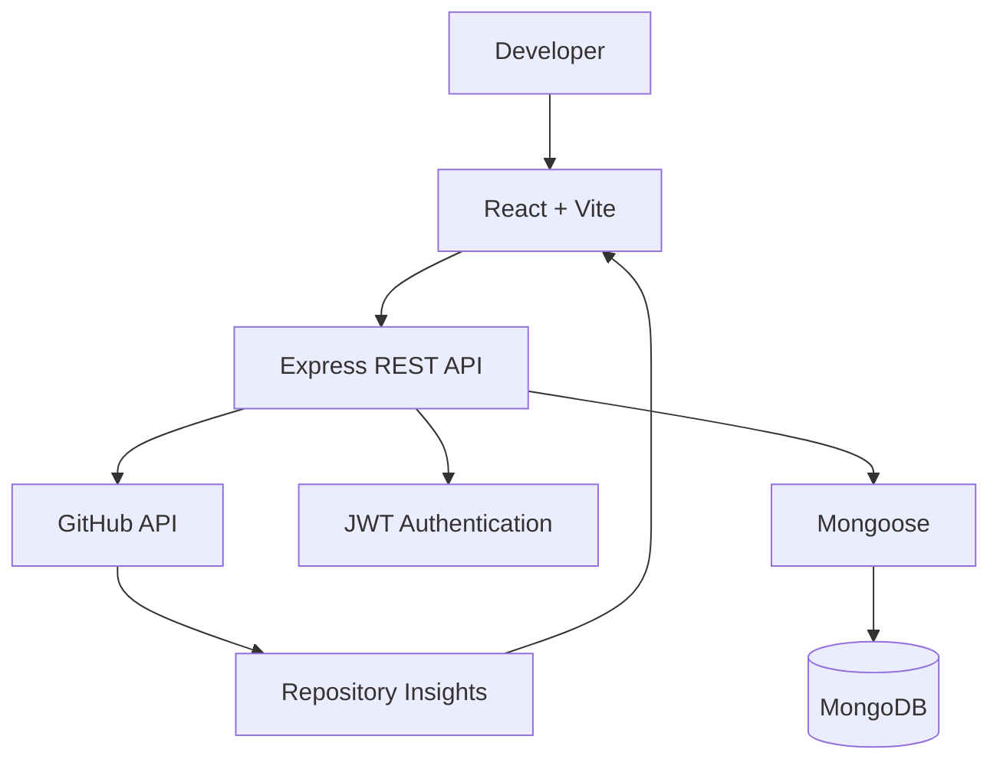

<div align="center">


### CSE & AI Student | Full-Stack Developer | Problem Solver

*Curious about what happens behind the screen — from a user's click to the data that makes it work.*

[](https://github.com/Priyanka170974)
[](https://www.linkedin.com/in/priyanka-jain-1b8978339)
[](https://leetcode.com/u/MCXH1ncUcC/)

</div>

---

## ✦ ABOUT ME

```javascript
const priyanka = {
  education: "B.Tech CSE & AI",
  college: "Arya College of Engineering",
  role: "Full-Stack Developer",
  interests: [
    "Backend Engineering",
    "System Design",
    "REST APIs",
    "Database Management",
    "Problem Solving"
  ],
  mindset: "Learn → Build → Debug → Improve"
};
```

I'm a Computer Science and Artificial Intelligence student who enjoys building practical applications and understanding how frontend, backend, APIs, and databases work together.

My goal is to become a software engineer who can turn ideas into reliable, user-friendly applications.

> 💡 Good code solves a problem. Great engineering understands the problem first.

---

## 🚀 FEATURED PROJECT — GITPULSE

### Repository Intelligence Dashboard

[](https://github.com/Priyanka170974/GitPulse)

GitPulse focuses on transforming GitHub repository information into useful visual insights through a developer-friendly dashboard.

**Key areas**
- Repository analytics
- Programming language insights
- Contributor information
- Commit activity
- GitHub API integration
- JWT authentication
- MongoDB data management

### Architecture



---

## 💻 OTHER PROJECTS

### 01. EventFlow — Event Registration & Smart Check-in

A full-stack platform for event management, attendee registration, ticket generation, and QR-based check-in.

- Organizer and volunteer access
- JWT authentication
- Event capacity validation
- QR tickets and PDF support
- Check-in verification
- Registration statistics

[🌐 Live Demo](https://event-registration-smart-checkin.vercel.app/) · [📂 Source Code](https://github.com/Priyanka170974/Event-Registration-Smart-Checkin)

### 02. Code-Master-Quiz

An interactive coding quiz built to make programming practice engaging through timed questions and instant feedback.

**Tech:** HTML · CSS · JavaScript

[🌐 Live Demo](https://priyanka170974.github.io/Code-Master-Quiz/) · [📂 Source Code](https://github.com/Priyanka170974/Code-Master-Quiz)

### 03. AWT Calculator

A Java desktop calculator exploring GUI components, arithmetic operations, and event handling.

**Tech:** Java · AWT

[📂 Source Code](https://github.com/Priyanka170974/AWT-Calculator)

### 04. Stopwatch

A responsive stopwatch with interactive controls and lap tracking.

**Tech:** HTML · CSS · JavaScript

[🌐 Live Demo](https://priyanka170974.github.io/StopwatchWebiste/) · [📂 Source Code](https://github.com/Priyanka170974/StopwatchWebiste)

---

## 🧰 TECH STACK

<div align="center">


</div>

| Category | Technologies |
|---|---|
| Languages | C, Java, JavaScript |
| Frontend | HTML, CSS, React, Vite |
| Backend | Node.js, Express.js, REST APIs |
| Databases | MongoDB, Mongoose, MySQL |
| Authentication | JWT, bcrypt, Role-based authorization |
| Tools | Git, GitHub, VS Code, IntelliJ IDEA |

---

## ⚙️ MY DEVELOPMENT WORKFLOW

<div align="center">

`IDEA` → `PLAN` → `DESIGN` → `DEVELOP` → `DEBUG` → `DEPLOY`

</div>

I believe in understanding the complete application rather than focusing on just one part.

- 🎨 **Frontend:** Building intuitive user experiences
- ⚙️ **Backend:** Designing APIs and application logic
- 🗄️ **Database:** Organizing and managing data
- 🔐 **Security:** Validating users and permissions
- 🧪 **Testing:** Finding and fixing unexpected issues
- 🌐 **Deployment:** Making applications accessible online

---

## 📊 GITHUB STATISTICS

<div align="center">


<br/>


</div>

---

## 🎯 CURRENT LEARNING GOALS

- Strengthening Data Structures and Algorithms
- Improving React and backend development
- Learning better API and database design
- Understanding authentication and authorization
- Building complete full-stack applications
- Exploring AI-powered software solutions

---

## 🎓 EDUCATION

**Arya College of Engineering**

B.Tech — Computer Science & Artificial Intelligence  
Third Year

**Certification:** NPTEL — Introduction to Programming in C

---

## 🤝 LET'S CONNECT

I'm interested in meaningful software projects, internships, collaboration, and opportunities to learn from real engineering challenges.

<div align="center">

[](https://github.com/Priyanka170974)
[](https://www.linkedin.com/in/priyanka-jain-1b8978339)
[](https://leetcode.com/u/MCXH1ncUcC/)

### `Curiosity → Code → Confidence → Impact`

*Thanks for visiting my profile. I'm learning, building, and improving one project at a time.*

</div>
