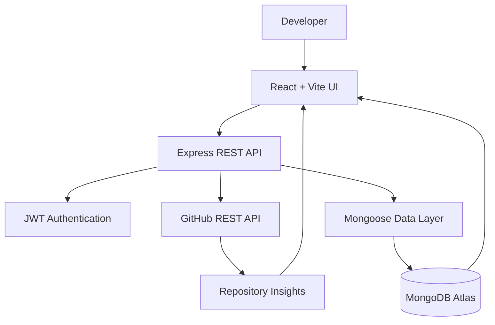

 <div align="center">


<br/>

<a href="https://github.com/Priyanka170974">

</a>
<a href="https://www.linkedin.com/in/priyanka-jain-1b8978339">

</a>
<a href="https://leetcode.com/u/MCXH1ncUcC/">

</a>

<br/><br/>

`CSE / AI STUDENT` &nbsp; `FULL STACK DEVELOPMENT` &nbsp; `SYSTEM THINKING`

</div>

---

## `01 / ENGINEERING IDENTITY`

```text
class Developer {
    String name = "Priyanka Jain";
    String education = "B.Tech CSE / AI";
    String focus = "Full Stack Engineering";
    String mindset = "Understand → Design → Build → Debug";

    String[] interests = {
        "Backend Architecture",
        "API Engineering",
        "Database Systems",
        "Developer Tools",
        "AI-powered Applications"
    };
}
```

I'm a third-year Computer Science and Artificial Intelligence student at **Arya College of Engineering**, interested in how software systems work beyond the user interface.

I enjoy building applications that connect frontend experiences, backend logic, APIs, authentication and databases into one functional system.

My goal is to grow into a software engineer who can understand a problem, design a reliable solution and build it from the ground up.

> **My engineering principle:** A good interface attracts attention. A well-designed system earns trust.

---

## `02 / CURRENTLY BUILDING`

<div align="center">

<a href="https://github.com/Priyanka170974/GitPulse">

</a>

### Repository Intelligence · GitHub API · MERN Stack

**Turning repository activity into an understandable engineering dashboard.**

</div>

GitPulse is a repository analytics project designed to transform GitHub data into visual insights. Instead of manually exploring repository pages, users can connect repository data with a dashboard for understanding activity, contributors and project composition.

#### System capabilities

| Module | Engineering purpose |
|---|---|
| Repository Analytics | Organizes GitHub repository metadata into a dashboard |
| Pulse Score | Presents a summary indicator for repository activity |
| Language Insights | Visualizes the repository's programming-language composition |
| Contributor Analytics | Displays available contributor information |
| Commit Activity | Helps explore repository activity over time |
| Clone Analytics | Displays traffic statistics when GitHub permissions allow access |
| Repository Origin | Shows available repository origin or fork information |
| Authentication | Uses JWT-based user authentication |
| Data Layer | Uses MongoDB and Mongoose for application data |

#### Architecture at a glance



#### Technology profile

<p>

</p>

<div align="center">

<a href="https://github.com/Priyanka170974/GitPulse">

</a>

</div>

---

## `03 / SELECTED BUILDS`

### ◈ EventFlow — Event Registration & Smart Check-in

**Full-stack workflow engineering · MERN · QR-based verification**

A platform for event creation, attendee registration, ticket generation and check-in. The project brings multiple event-management operations together behind a role-aware application.

**Engineering highlights**
- Organizer and volunteer access controls
- JWT authentication and password hashing
- Event capacity and duplicate-registration checks
- QR ticket generation and PDF support
- Camera-based QR scanning with manual ticket lookup
- Check-in validation and registration statistics

<p>


</p>

[↗ Live Application](https://event-registration-smart-checkin.vercel.app/) · [↗ Source Code](https://github.com/Priyanka170974/Event-Registration-Smart-Checkin)

---

### ◈ Code-Master-Quiz

**Interactive learning · Frontend engineering · JavaScript**

A browser-based coding quiz that makes programming practice more engaging through timed questions, interactive feedback and a responsive interface.

- Programming questions and timed quiz sessions
- Dynamic interface interactions
- Score and feedback-oriented experience
- Client-side logic with HTML, CSS and JavaScript

<p>


</p>

[↗ Live Application](https://priyanka170974.github.io/Code-Master-Quiz/) · [↗ Source Code](https://github.com/Priyanka170974/Code-Master-Quiz)

---

### ◈ AWT Calculator

**Java desktop development · GUI · Event handling**

A desktop calculator built using Java AWT, exploring graphical components, user input and event-driven programming.

- Interactive calculator controls
- Arithmetic operation handling
- Java GUI components and event listeners

<p>


</p>

[↗ Source Code](https://github.com/Priyanka170974/AWT-Calculator)

---

### ◈ Stopwatch

**Browser APIs · State management · Responsive UI**

A stopwatch web application focused on time tracking, lap recording and interactive controls.

- Start, pause and reset controls
- Lap tracking and history management
- Responsive, themed interface

<p>


</p>

[↗ Live Application](https://priyanka170974.github.io/StopwatchWebiste/) · [↗ Source Code](https://github.com/Priyanka170974/StopwatchWebiste)

---

## `04 / TECHNICAL TOOLKIT`

<div align="center">

| DOMAIN | TECHNOLOGIES |
|---|---|
| Languages | C · Java · JavaScript |
| Frontend | HTML5 · CSS3 · React |
| Backend | Node.js · Express.js · REST APIs |
| Databases | MongoDB · MySQL |
| Data Access | Mongoose |
| Security | JWT · bcrypt · Role-based authorization |
| Developer Tools | Git · GitHub · VS Code · IntelliJ IDEA |
| Concepts in Progress | Data Structures · Algorithms · Operating Systems |

</div>

---

## `05 / HOW I APPROACH A SYSTEM`

<div align="center">

```text
       PROBLEM
          │
          ▼
   REQUIREMENTS
          │
          ▼
   SYSTEM DESIGN
          │
          ▼
   IMPLEMENTATION
          │
          ▼
  TESTING & DEBUGGING
          │
          ▼
     DEPLOYMENT
          │
          ▼
     ITERATION
```

</div>

When building a project, I try to understand the complete flow rather than focusing only on individual features.

- **Frontend:** How does the user interact with the system?
- **Backend:** How is each request validated and processed?
- **Database:** How should application data be structured and stored?
- **Security:** Which actions should each user be allowed to perform?
- **Reliability:** What happens when an API fails or input is invalid?
- **Deployment:** Can the application run outside the local development environment?

These are the questions I want to get better at answering with every project.

---

## `06 / GITHUB ACTIVITY`

<div align="center">


<br/><br/>


<br/><br/>


</div>

---

## `07 / LEARNING TRACK`

```text
COMPUTER SCIENCE
├── Programming Fundamentals
│   ├── C
│   └── Java & OOP
├── Problem Solving
│   └── Data Structures & Algorithms
├── Web Engineering
│   ├── HTML / CSS / JavaScript
│   └── React
├── Backend Engineering
│   ├── Node.js / Express
│   ├── REST APIs
│   └── Authentication
├── Data Management
│   ├── MongoDB / Mongoose
│   └── MySQL
└── Emerging Interests
    └── AI-powered Software Applications
```

### Current priorities

- Strengthening data structures and problem-solving fundamentals
- Improving React and backend API design
- Understanding authentication, authorization and database design
- Building projects with complete frontend-to-backend workflows
- Exploring practical ways to integrate AI into software applications

---

## `08 / EDUCATION`

**Arya College of Engineering**  
B.Tech — Computer Science & Artificial Intelligence  
Third Year

**Certification:** NPTEL — Introduction to Programming in C

---

## `09 / CONNECT`

I'm interested in software development, meaningful project work, internships and opportunities to learn from real engineering challenges.

<div align="center">

<a href="https://www.linkedin.com/in/priyanka-jain-1b8978339">

</a>

<a href="https://leetcode.com/u/MCXH1ncUcC/">

</a>

<a href="https://github.com/Priyanka170974">

</a>

</div>

---

<div align="center">


### `THINK IN SYSTEMS. BUILD WITH PURPOSE.`

**Curiosity → Code → Engineering → Impact**

<sub>Thanks for exploring my developer profile.</sub>

</div>
