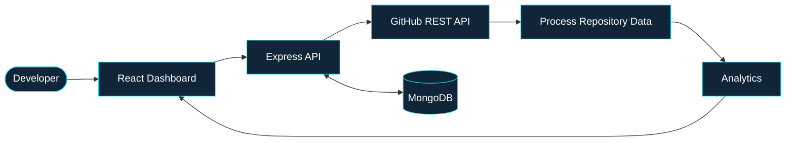
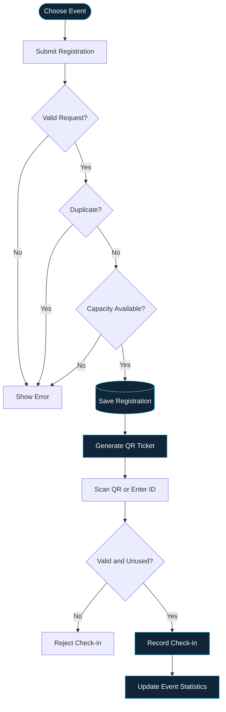

# PRIYANKA JAIN

<p align="center">
  <i>COMPUTER SCIENCE & AI · FULL-STACK DEVELOPMENT</i>
</p>

<p align="center">
  <b>Turning ideas into working systems.</b><br/>
  I build applications by connecting thoughtful interfaces, backend logic, and structured data.
</p>

<p align="center">
  <a href="https://github.com/Priyanka170974">GITHUB</a> &nbsp; / &nbsp;
  <a href="https://www.linkedin.com/in/priyanka-jain-1b8978339">LINKEDIN</a> &nbsp; / &nbsp;
  <a href="https://leetcode.com/u/MCXH1ncUcC/">LEETCODE</a>
</p>

---

## THE WORKROOM

I’m a Computer Science and AI student who enjoys understanding how software works from the inside out — from the first user interaction to API processing, database operations, and the final result.

My approach is simple: understand the problem, design the workflow, build the solution, and keep improving it.

| FOCUS | TOOLKIT |
|---|---|
| Languages | C · Java · JavaScript |
| Interface | HTML · CSS · React · Vite |
| Server | Node.js · Express.js · REST APIs |
| Data | MongoDB · Mongoose · MySQL |
| Workflow | Git · GitHub · VS Code |
| Concepts | JWT · Role-Based Access · CRUD · API Integration |

---

## SELECTED WORK — `01 / 05`

### 01. GitPulse
**Repository intelligence, made visual.**

GitPulse transforms GitHub repository information into a structured analytics dashboard. The project combines API integration, data processing, authentication, and persistent application data.



**What it does**
- Retrieves repository information through the GitHub API.
- Presents language, contributor, and commit activity insights.
- Organizes repository metrics into a dashboard.
- Uses JWT authentication and MongoDB-backed application data.

`REACT` / `VITE` / `NODE.JS` / `EXPRESS` / `MONGODB` / `MONGOOSE`

[EXPLORE THE PROJECT ↗](https://github.com/Priyanka170974/GitPulse)

---

### 02. EventFlow
**From event registration to verified entry.**

An event registration and smart check-in platform built around digital tickets, attendee validation, and event management.



**What it does**
- Organizer and volunteer roles.
- Event creation and management.
- Registration capacity and duplicate checks.
- QR ticket generation and PDF support.
- Camera-based scanning and manual ticket lookup.
- Check-in validation and event statistics.

`REACT` / `NODE.JS` / `EXPRESS` / `MONGODB` / `JWT` / `QR SCANNING`

[VIEW SOURCE CODE ↗](https://github.com/Priyanka170974/Event-Registration-Smart-Checkin) · [OPEN LIVE DEMO ↗](https://event-registration-smart-checkin.vercel.app/)

---

### 03. Code-Master-Quiz
**Learning through interaction.**

A programming quiz website designed around timed questions, score tracking, and interactive feedback.

- Programming questions across multiple languages.
- Countdown timer and score tracking.
- Interactive answer feedback and result experience.
- Leaderboard and visual effects.

`HTML` / `CSS` / `JAVASCRIPT`

[VIEW SOURCE CODE ↗](https://github.com/Priyanka170974/Code-Master-Quiz) · [OPEN LIVE DEMO ↗](https://priyanka170974.github.io/Code-Master-Quiz/)

---

### 04. AWT Calculator
**A desktop interface built with Java.**

A graphical calculator demonstrating Java AWT components, button events, and arithmetic operations.

- Desktop GUI components.
- Event-driven interactions.
- Arithmetic operations and result display.

`JAVA` / `AWT`

[VIEW SOURCE CODE ↗](https://github.com/Priyanka170974/AWT-Calculator)

---

### 05. Stopwatch
**Small interactions, carefully designed.**

A responsive stopwatch featuring time controls, lap tracking, and a dark-mode interface.

- Start, pause, resume, and reset.
- Lap tracking and lap-history controls.
- Responsive layout and dark mode.

`HTML` / `CSS` / `JAVASCRIPT`

[VIEW SOURCE CODE ↗](https://github.com/Priyanka170974/StopwatchWebiste) · [OPEN LIVE DEMO ↗](https://priyanka170974.github.io/StopwatchWebiste/)

---

## HOW I BUILD

```text
01  UNDERSTAND THE PROBLEM
          ↓
02  MAP THE USER WORKFLOW
          ↓
03  DESIGN THE DATA FLOW
          ↓
04  IMPLEMENT THE LOGIC
          ↓
05  TEST · DEBUG · IMPROVE
```

I focus on understanding why each component exists, how it communicates with the rest of the application, and what happens when a request fails or an edge case appears.

## CURRENT DIRECTION

- Strengthening full-stack development fundamentals.
- Practising data structures and algorithms.
- Improving API design and database modelling.
- Building practical, portfolio-ready applications.

---

<p align="center">
  <b>Good software is more than what you see.</b><br/>
  <sub>It is the logic, decisions, and details working together behind the interface.</sub>
</p>

<p align="center">
  <a href="https://github.com/Priyanka170974">EXPLORE MY GITHUB →</a>
</p>
