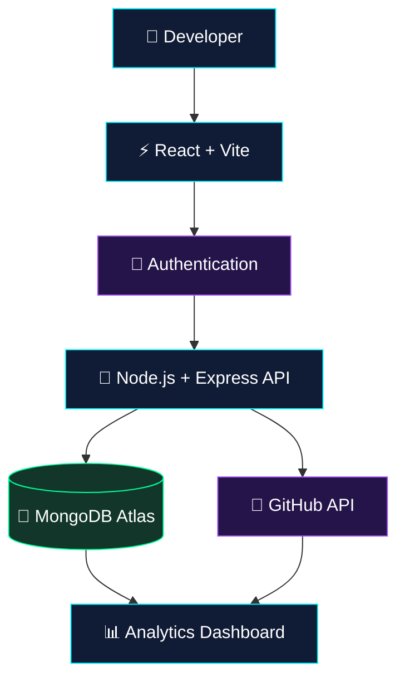

<div align="center">


<br/>


</div>

---

## `01 // SYSTEM OVERVIEW`

> **GitPulse** is a GitHub analytics dashboard designed to transform repository activity into meaningful insights through a clean, data-driven interface.

Instead of jumping between repositories and activity pages, GitPulse brings important development information together in one place.

<table>
<tr>
<td width="50%">

### ◈ REPOSITORY INSIGHTS

- Repository information
- Language distribution
- Commit activity
- Contribution overview

</td>
<td width="50%">

### ◈ DEVELOPER DASHBOARD

- Centralized analytics
- User authentication
- Organized data visualization
- Repository activity tracking

</td>
</tr>
</table>

---

## `02 // VISUAL INTERFACE`

<div align="center">


<sub>Replace this placeholder with an actual screenshot of your GitPulse dashboard.</sub>

</div>

---

## `03 // SYSTEM ARCHITECTURE`



---

## `04 // TECHNOLOGY MATRIX`

<div align="center">

| MODULE | TECHNOLOGY |
|:---|:---|
| `FRONTEND` | React · Vite · JavaScript |
| `BACKEND` | Node.js · Express.js |
| `DATABASE` | MongoDB Atlas · Mongoose |
| `SECURITY` | JWT Authentication |
| `DATA SOURCE` | GitHub REST API |
| `VERSION CONTROL` | Git · GitHub |

<br/>


</div>

---

## `05 // CORE FEATURES`

<details>
<summary><b>⚡ Repository Intelligence</b></summary>

Explore repository details and organize useful development metrics in one dashboard.

</details>

<details>
<summary><b>📊 Language & Activity Analytics</b></summary>

Understand repository language distribution and available contribution or commit activity data.

</details>

<details>
<summary><b>🔐 Authentication Layer</b></summary>

JWT-based authentication helps protect user-specific dashboard features.

</details>

<details>
<summary><b>🌐 GitHub API Integration</b></summary>

Retrieve supported repository and activity information from GitHub's API.

</details>

---

## `06 // PROJECT LINKS`

<div align="center">

<a href="https://github.com/Priyanka170974/GitPulse">

</a>

<a href="https://github.com/Priyanka170974">

</a>

</div>

---

## `07 // DEVELOPER CONSOLE`

<div align="center">


<br/>


</div>

---

## `08 // EXECUTION LOG`

```text
[ OK ]  Frontend interface       React + Vite
[ OK ]  Backend services         Node.js + Express
[ OK ]  Data persistence         MongoDB + Mongoose
[ OK ]  Authentication           JWT
[ OK ]  External integration     GitHub API
[ .. ]  Continuous improvements  IN PROGRESS
```

---

<div align="center">


### `BUILD • ANALYZE • IMPROVE`

<sub>GitPulse — turning repository activity into developer insights.</sub>

<br/>


</div>
